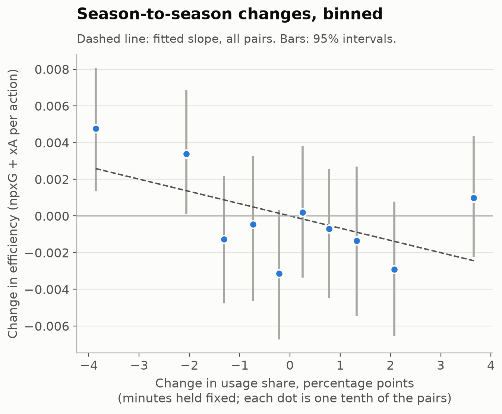

# Usage and efficiency in football

**What happens to a footballer's output when his share of his team's play changes?**

## The answer

If there is a trade-off, it is small. When the same attacker's share of his team's shots and shot-assists rises by 5 percentage points from one season to the next, with his minutes held fixed, his non-penalty xG plus xA per action falls by about 1.7%. The 95% interval runs from a 3.4% fall to a 0.1% rise, so the cleanest version of the test cannot rule out no effect at all. Simpler versions put the fall at 2% to 3%, with intervals clear of zero.

The fall shows most clearly in players who change club (−4.4%). For them it disappears when their output is measured against their new team-mates (−0.3%, with a wide interval): a player who moves into a bigger role often joins a team that makes worse chances for everyone. Players who stay at the same club show no clear drop (−0.9%). For a scout, that means a player's efficiency mostly travels with him, and his share of the ball is set by the club he joins.


*Across 4,592 attacker seasons in the Big-5 leagues and Russia (2014-15 to January 2025), efficiency is flat at about 0.12 per action from 4% to 14% usage and sits about 8% lower above 18%. The three careers are discussed below.*

## Why ask this

Basketball has studied this for 20 years. Dean Oliver's usage rate measures the share of a team's possessions a player ends while he is on the floor, and his skill curves show that most players get less efficient as they are asked to do more. A player who takes the team's worst shots at the end of the shot clock has a high usage rate and a low efficiency, and the two are linked.

Football has the same structure. A team creates a roughly fixed number of attacking actions in a season, so usage behaves like a conserved quantity: the shares in a team always sum to one, and one player's rise has to come out of his team-mates' shares. If efficiency falls steeply as usage rises, a signing who takes the ball off better-placed team-mates makes the team worse even when his own numbers look good. That is the question a club is really asking before it pays a fee.

## Method

### Definitions

The definitions are the ones the wider transfer model uses (`src/usage_model/usage.py`), applied unchanged.

- **Usage share** is a player's shots plus shot-assists, as a share of his team's total over the league season.
- **Efficiency** is the non-penalty xG plus xA he produces per one of those actions.

Penalties and own goals are excluded. Usage and efficiency come from Understat shot data. Minutes and positions come from Transfermarkt, joined through an id crosswalk.

### Sample

I kept forwards and attacking midfielders (Transfermarkt position "Attack" or "Attacking Midfield") with at least 900 league minutes in a season. That leaves 4,592 player-seasons from 1,436 players.

The 900-minute floor comes from a split-half test. I split each team's league matches into odd and even, measured efficiency on each half, and correlated the two:

| League minutes | Seasons | Efficiency reliability | Usage reliability |
|---|--:|--:|--:|
| under 450 | 2,116 | 0.11 | 0.66 |
| 450 to 899 | 1,391 | 0.34 | 0.71 |
| 900 to 1,799 | 2,363 | 0.58 | 0.83 |
| 1,800 and over | 2,229 | 0.73 | 0.87 |

*Reliability is the split-half correlation stepped up to a full season (Spearman-Brown).*

Below 900 minutes, most of the variation in a player's efficiency is noise. Above it, more than half is signal. Usage is measured more reliably than efficiency at every level.

When a player changes club mid-season, I keep the club that holds at least 80% of his actions and drop the season otherwise. That keeps Ronaldo's 2021-22 (one Juventus match, then United).

### Across players: the curve

I binned player-seasons by usage share and computed total value over total actions in each bin. The 95% intervals come from a bootstrap that resamples whole players, because a player's seasons are not independent.

The curve is flat until about 14% usage and then dips by about 8%. This comparison mixes two things, though: better players get more of the ball, and better teams make better chances. So the test that matters is the one within players.

### Within players: the main test

The cleaner test follows the same player into the next season. I took every pair of consecutive seasons where the player passed the 900-minute floor in both (2,646 pairs, 883 players, 592 club changes) and regressed the change in efficiency on the change in usage share. Each pair is weighted by the precision of its efficiency change, `1 / (1/actions₁ + 1/actions₂)`, so a pair built on 300 actions counts for more than one built on 60.

Four problems needed handling, and each one moved the number:

1. **Usage share contains minutes.** The repo's usage share uses the whole season as its denominator, so it is roughly (share of the season played) × (share of play while on the pitch). Usage share and share of the season played correlate at 0.85 here. A player in form plays more, so his usage share rises with his efficiency. With nothing held fixed the slope is zero (−0.1%, interval −1.3% to +1.1%). Holding the change in minutes fixed gives −2.9% (−5.2% to −0.6%). Using usage per minute on the pitch instead gives −2.0% (−3.5% to −0.5%).
2. **Shared noise.** A speculative 0.03 xG shot raises a player's usage and lowers his efficiency in the same match, which builds a negative slope out of nothing. I measured usage on odd matches and efficiency on even matches (and the reverse, then averaged). I chose this as the headline before running it: **−0.0019 xG+xA per action per 5 points of usage, or −1.7% of the median efficiency of 0.115 (interval −3.4% to +0.1%).** Removing the shared noise shrinks the slope by about a third, and its interval now just touches zero.
3. **Regression to the mean.** A player coming off a lucky season tends to drift back down whatever happens to his role, and a coach may hand more of the ball to a player who just had a good year. Adding last season's efficiency, measured on the other half of the matches, as a control leaves the slope unchanged at −1.7% (−3.4% to +0.1%).
4. **Changing team.** A move changes the quality of chances everyone on the team gets. I ran club changers and stayers separately, and then measured efficiency relative to team-mates' efficiency that season. Against team-mates, the club changers' fall vanishes. Across everyone it stays at about −2%, so team context accounts for the movers' fall and leaves the pooled slope in place.


| Specification | Pairs | Change per +5 points of usage | 95% interval |
|---|--:|--:|--:|
| Usage share as defined, nothing fixed | 2,646 | −0.1% | −1.3% to +1.1% |
| Holding minutes fixed | 2,646 | −2.9% | −5.2% to −0.6% |
| Usage per minute on the pitch | 2,646 | −2.0% | −3.5% to −0.5% |
| **Split-half, minutes fixed (headline)** | 2,646 | **−1.7%** | **−3.4% to +0.1%** |
| Split-half plus last season's efficiency | 2,646 | −1.7% | −3.4% to +0.1% |
| Same club both seasons | 2,054 | −0.9% | −3.6% to +1.8% |
| Changed club | 592 | −4.4% | −8.6% to −0.1% |
| Changed club, against new team-mates | 592 | −0.3% | −4.0% to +3.5% |
| Everyone, against team-mates | 2,646 | −2.1% | −4.1% to +0.0% |

*Percentages are of the median efficiency (0.115 npxG+xA per action). Intervals come from 2,000 bootstrap draws resampling whole players. Full table in `data/within_slopes.csv`.*

The binned version shows where the slope comes from. Most of it rests on the fifth of pairs where usage fell hardest: those players' efficiency rose by 0.003 to 0.005 per action. In the tenth where usage rose most, efficiency barely moved. Losing the ball seems to help a little more than gaining it hurts.



## Three players

The season numbers are in `data/case_studies.csv`.

**Memphis Depay** went from 9.3% usage at Manchester United in 2015-16 to 18.1% at Lyon in 2017-18 and 18.6% in 2020-21. On the curve, that looks like a player handed twice the ball. Almost all of it was minutes: he played 43% of United's league minutes and 75% then 86% of Lyon's. His share of play while on the pitch barely moved (22%, 24%, 22%). His efficiency rose, from 0.086 to 0.107 to 0.124, which runs against the trade-off. At United he was short of minutes. He was not short of the ball. His PSV seasons are invisible here because Understat does not cover the Eredivisie.

**Anthony Martial** moved from Monaco (7.7% usage, 0.192 efficiency) to United in 2015-16 (12.7%, 0.143). That is the trade-off at its sharpest: a 25% fall in efficiency for 5 more points of usage. Two things soften it. His Monaco season rests on 61 actions, so part of the 0.192 is likely luck. And United's attackers as a whole made worse chances than Monaco's that season (0.098 per action against 0.109). Over the next five seasons at United he sat between 0.106 and 0.170 at 6% to 12% usage, with no clear pattern.

**Cristiano Ronaldo** went from 18.6% usage at Juventus in 2020-21 to 14.6% at United in 2021-22, and his efficiency held (0.142, then 0.146), well above his United team-mates (0.102). By his own per-action numbers he did fine. In the wider model's on/off measure (WOWY, the team's xG difference per 90 with him on the pitch against off it, shrunk towards zero when the off-pitch sample is thin), United were 0.25 xGD per 90 worse with him on. Per-action efficiency cannot see that cost. It would show up in what the team does around a player, such as pressing, or in possessions that never reach a shot. That case is the reason the wider model checks team outcomes as well as individual ones.

## Limitations

- **Coverage.** Understat covers the Big-5 leagues and the Russian Premier League only, from 2014-15. There is no Eredivisie, Primeira Liga or Championship, so selling-league seasons such as Depay's at PSV or Antony's at Ajax are invisible. Russian seasons appear only for players the crosswalk could match through a Big-5 season (99 player-seasons).
- **Attackers only.** Efficiency here counts shots and the pass before a shot. It says nothing useful about defenders or deep midfielders, which is why the sample is forwards and attacking midfielders. Positions are each player's Transfermarkt position, which is fixed across his career.
- **Efficiency is a proxy.** npxG + xA per action measures the quality of chances a player takes and creates. It is blind to finishing skill above xG, to carries and progression that do not end in a shot, to turnovers, and to defending. The full usage definition in the model adds turnovers, but that data comes from a frozen FBref/Opta snapshot that cannot be shared.
- **Usage denominator.** Usage share uses the team's whole season as the denominator, so it mixes minutes with share of play. I handled that by holding minutes fixed and by a per-minute version, and the two agree.
- **Noise.** Efficiency on fewer than 100 actions is noisy. The 900-minute floor, precision weights and split-half design reduce the damage and leave some behind.
- **Regression to the mean and coaching.** If a coach hands more of the ball to whoever is in form, the season-to-season pattern partly reflects his choices. The baseline control absorbs the obvious version of this, and does not rule out subtler ones.
- **Survivorship.** A pair needs 900 minutes in both seasons. A player whose role collapsed after a bad season drops out, which probably hides some of the steepest falls.
- **Correlation.** This is an observational design. Nothing here has an experiment behind it.
- **Frozen data.** The shot data was frozen on 4 January 2025, halfway through 2024-25. Minutes for that season are counted to the same date. Transfermarkt minutes and positions are crowd-maintained.
- **Licences.** Understat and Transfermarkt data are used for non-commercial research. Neither is redistributed here (see `data/DATA.md`).

## How this fits the wider model

This repo is one question taken from a larger transfer valuation model, which lives in a private repository because it is built on data that cannot be redistributed. That model keeps three questions apart:

1. **How good is he?** A talent score built price-blind: market value, wage and fee are never inputs, and the code refuses to fit if a price-like column appears (`src/usage_model/talent.py`, reference copy).
2. **What is he worth to this club?** A club-specific value that turns expected xG difference into league position and then into revenue, including the step in revenue that comes with Champions League qualification.
3. **What will he cost?** A fee model trained on disclosed transfer fees, validated season by season on later seasons only.

The usage idea sits underneath all three: a signing helps only if his efficiency beats the efficiency of the play he takes over. The finding here supports that assumption: efficiency mostly travels with the player. An earlier test found that a usage-weighted efficiency gap predicts the change in a team's xG difference after 2,364 transfers, with a small effect (r = +0.083, interval +0.042 to +0.123).

Out of time, the talent model's undervalued-player screen picked players whose market value doubled within two years at 23.5%, against a base rate of 13.2% (1,806 players screened). It passes two of its four pre-registered tests and fails two:

- It reads Haaland's injury-shortened 2021-22 at Dortmund as an ordinary season, because it cannot tell a star's injury from a fringe player's time on the bench. Antony could not be scored at all, because his Ajax season is in the Eredivisie.
- Its decile test points the right way (the top tenth outgrows the bottom tenth, with an interval clear of zero) but only 5 of 9 steps rise, against a bar of 6.

The tests were set before the results were seen and have not been loosened.

## Reproduce it

You need Python 3.11 or later and your own copy of the source data (see `data/DATA.md`).

```bash
python -m venv .venv
.venv/bin/pip install -r requirements.txt
export SOURCE_DATA=/path/to/your/raw/data     # layout in data/DATA.md
./run_all.sh
```

`run_all.sh` runs three scripts, in about three minutes:

| Script | What it does |
|---|---|
| `analysis/build_panel.py` | Builds the player-season panel from raw data into `data/work/` (gitignored) |
| `analysis/analyse.py` | Computes every number above and writes the small tables in `data/` |
| `analysis/figures.py` | Draws the three figures from those tables, as PNG and SVG |

The model code in `src/usage_model/` has offline self-checks: `PYTHONPATH=src python -m usage_model.usage` (and the same for `wowy` and `understat`).

## Data and attribution

- Shot-level xG from [Understat](https://understat.com), via the [worldfootballR_data](https://github.com/JaseZiv/worldfootballR_data) archive by Jason Zivkovic.
- Minutes, positions and the transfer records behind the wider model from [Transfermarkt](https://www.transfermarkt.com), via [transfermarkt-datasets](https://github.com/dcaribou/transfermarkt-datasets) by David Cariboo.

No raw third-party data is included. `data/` holds only aggregate tables computed here, plus season-level usage and efficiency for the three players discussed above. Code is MIT-licensed (`LICENSE`). The data keeps its owners' terms.

## About

Ben Rimmer, First-class BSc Economics, University of Exeter. benedict.p.rimmer@gmail.com
