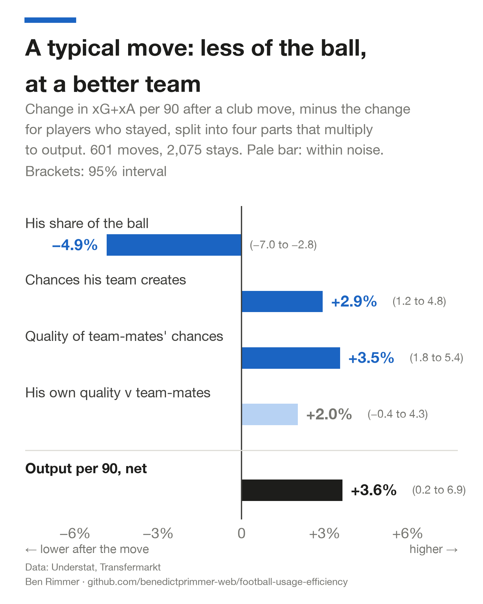
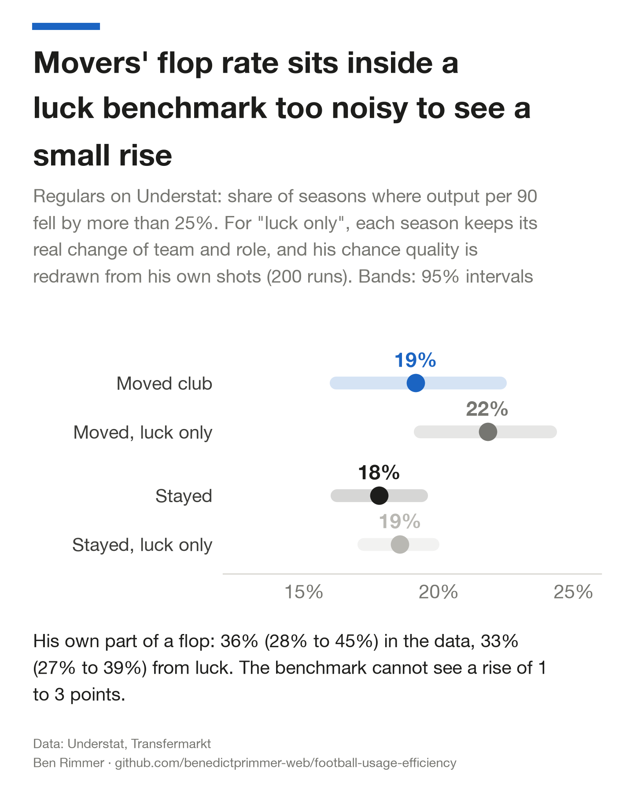
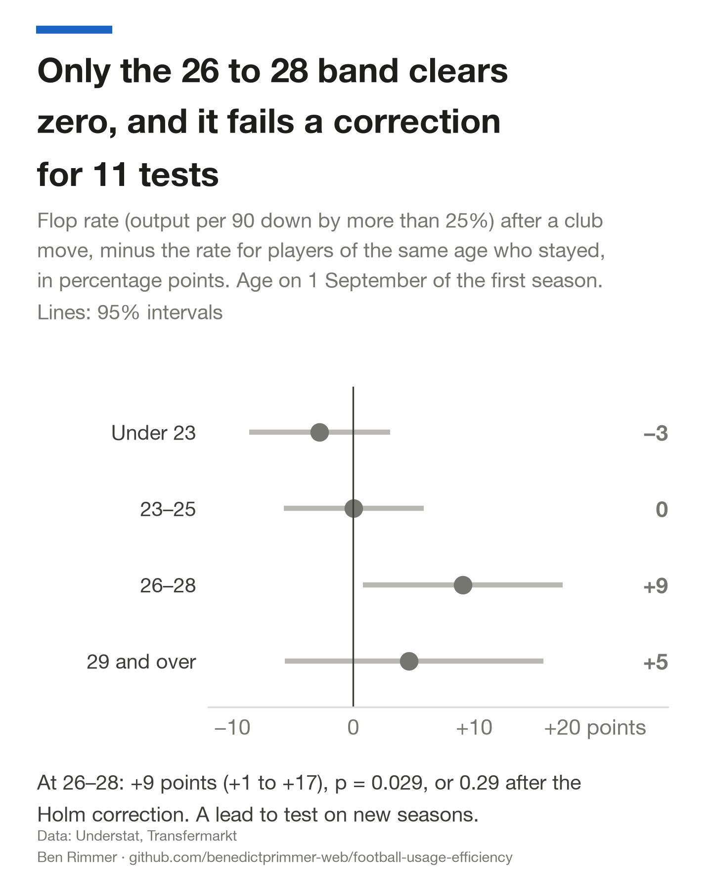
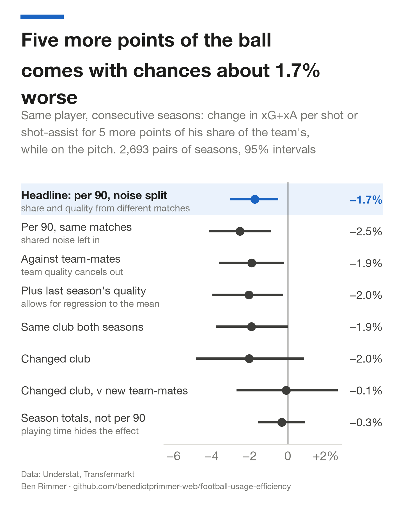
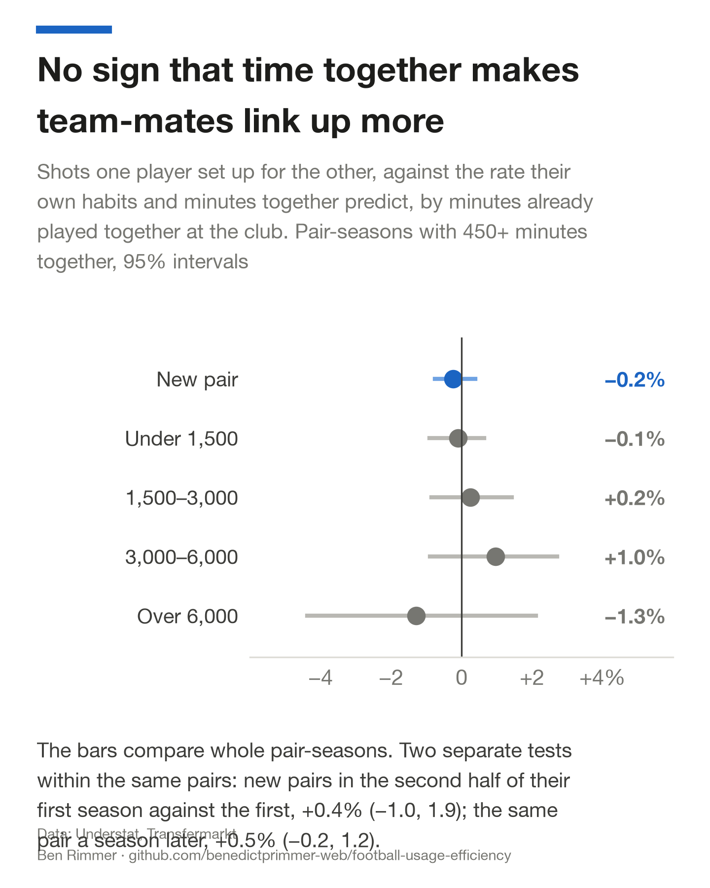
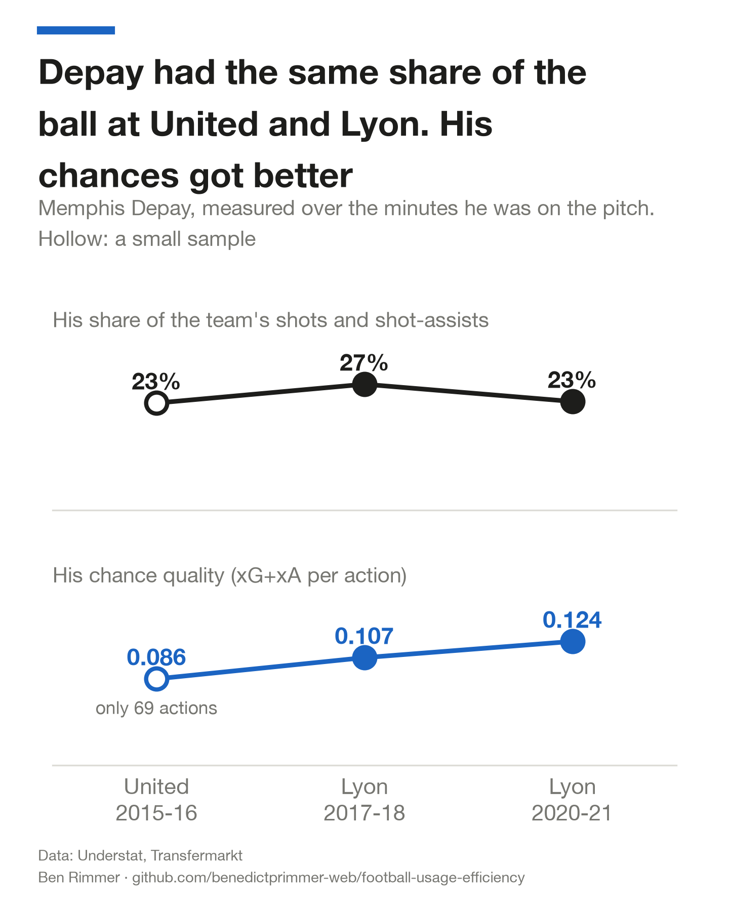

# Why do transfers fail? A look at usage rates in football

**When an attacker's output falls after a move, did he get worse, or did the move change his situation?**

I followed every attacker in the Big-5 leagues who played 900 league minutes in two seasons in a row, from 2014-15 to 2024-25: 601 club moves and 2,075 seasons where the player stayed. Output is expected goals plus expected assists per 90 minutes (xG+xA: the chance a shot is scored, plus the xG of the shots he set up), counted only over the minutes he was on the pitch. Usage is his share of the ball: his shots and shot-assists as a share of his team's while he is on. A flop is a season where output per 90 falls by more than 25%.

## What I found

**Moving club costs an attacker about 5% of his share of the ball, and the better team he joins makes up for it.**

- Compared with players who stayed, a mover's share of his team's shots and shot-assists falls by 4.9% (95% interval −7.0% to −2.8%).
- His new team creates more chances (+2.9%) and better ones (+3.5%), so per 90 he ends up 3.6% ahead of stayers (0.2% to 6.9%), or 3.0% after adjusting for age (−0.5% to +6.9%).
- Losing the ball is about a quarter of a flop. It accounts for 28% of the average fall for movers (20% to 36%) and 23% for stayers, and 32% of movers' flops would not have been flops had his share held.
- Movers flopped 19% of the time and stayers 18%, a gap of 1.4 points (95% interval −2.1 to +4.9), or 2.7 points after adjusting for age (−1.0 to +6.7). If each player's quality against his team-mates stayed exactly the same and only luck moved it, the moves in this sample would flop 22% of the time. The benchmark runs a little high: it gives stayers 19% against a real 18%.



*Four parts multiply to output per 90: the chances his team creates, his share of them, the quality of team-mates' chances, and his own quality against team-mates. Each bar is movers minus stayers.*

## Why it matters

One season of chances is a small sample. A club that reads a bad first season as a bad signing can end up selling a player whose quality has not changed, and the next section shows how much of that first season luck alone can produce.

## Flops look like luck

Picking moves by a big fall also picks bad luck, so I measured how much luck alone produces. For each pair of seasons I kept the real change of team and role, fixed the player's quality against his team-mates, and redrew his chance quality from his own shots, 200 times.

| | Flop rate, data | Flop rate, luck only | Player's part of a flop, data | Player's part, luck only |
|---|--:|--:|--:|--:|
| Moved club | 19% | 22% (20% to 24%) | 39% | 33% (28% to 38%) |
| Stayed | 18% | 19% (17% to 20%) | 42% | 39% (36% to 41%) |

On stayers the benchmark comes within a point of the real flop rate, so it is close to calibrated, if a little high. For movers it gives about as many flops as the data, so a flop rate on its own cannot show that players got worse. The player's own part of a flop is a little larger in the data (39%) than from luck alone (28% to 38%), so some real change in quality does show through. About 70% of the spread in a mover's change of quality against team-mates is what sampling noise alone would give.



## Who flops



- **Age.** Movers aged 26 to 28 flop 28% of the time, against 19% for stayers of the same age (gap +9 points, +1 to +17), and movers aged 29 and over 26%. Under 23 the movers do slightly better than the stayers. The 26–28 band is the only one of four with an interval clear of zero, so it is a lead to test on new seasons.
- **League.** Players who move to a new league flop 22% of the time, against 17% for movers within the same league.
- **Fee.** I found no clear pattern: 20% of moves over €30m flop, 17% at €10–30m, 13% under €10m and 19% of free or loan moves, and every interval overlaps. 149 moves have no fee on record in Transfermarkt.
- **Buying club.** I cannot tell whether some clubs' signings do better. After shrinking each club's record towards the average the spread between clubs is close to zero, and only 11 clubs made enough signings to compare 2015–19 with 2020–25 (rank correlation −0.19, p = 0.57).
- **Can you see it coming?** Using only what is known on the day of the move, a simple model trained on moves into 2015-16 to 2019-20 and tested on 2020-21 onwards scores an AUC (the chance it ranks a random flop above a random non-flop) of 0.62 (0.54 to 0.70). The fifth of moves it rates riskiest flop 23% of the time, against 16% for the rest. The strongest warning sign is a big season just before the move, which is partly regression to the mean.

<br clear="right">

## A second source: Opta xG in seven leagues

Understat covers only the Big-5. FBref carried Opta's shot-level xG for many more leagues until January 2026, and the [worldfootballR_data](https://github.com/JaseZiv/worldfootballR_data) archive kept it, so I reran every test on Opta's numbers for the Big-5 plus Portugal and the Eredivisie, 2017-18 to 2024-25. A different xG model, different shot-assist definitions and two more leagues give a fair test of whether the results hold.

| | Understat, Big-5, 2014–2025 | Opta, seven leagues, 2017–2025 |
|---|---|---|
| Moves / stays | 601 / 2,075 | 469 / 1,716 |
| His share of the ball, movers v stayers | −4.9% (−7.0% to −2.8%) | −7.2% (−9.6% to −4.8%) |
| Chances his team creates | +2.9% (+1.2% to +4.8%) | +3.9% (+1.8% to +6.0%) |
| Output per 90, net | +3.6% (+0.2% to +6.9%) | +0.4% (−3.4% to +4.1%) |
| Flop rate, moved v stayed | 19% v 18% | 24% v 20% |
| Flop gap, adjusted for age | +2.7 points (−1.0 to +6.7) | +4.8 points (+0.5 to +9.6) |
| Flop rate, luck only (movers) | 22% | 25% |
| Losing the ball, share of a mover's flop | 28% | 32% |
| Same player, 5 points more of the ball | −1.7% | −1.2% |
| Flop predictor AUC, out of time | 0.62 | 0.70 (0.64 to 0.76) |

The usage cost holds and is larger on Opta. The better team makes up for it on Understat; on Opta it roughly breaks even. On Opta movers flop a little more often than stayers once age is accounted for, and the predictor does better.

**Stepping up from Portugal or the Eredivisie.** 38 attackers moved from those leagues into the Big-5 with 900 minutes either side. Their output per 90 fell by 28% (21% to 35%) and 53% of them flopped. The whole fall came from the situation (−29%): against their new team-mates their quality was unchanged (+0.6%, −6.7% to +7.9%). A stronger league means fewer chances and less of the ball, and the player is as good as he was. It is a small sample.

## The same player with more of the ball

The second test follows one player from one season to the next: 2,693 pairs of seasons from 897 players. Seasons where his share of the team's shots and shot-assists was 5 points higher came with chance quality **1.7%** lower (95% interval −3.0% to −0.5%).

That headline measures his share on odd matches and his quality on even matches (and the reverse). One speculative shot raises his share and lowers his quality in the same match, and splitting the matches removes that shared noise. Measuring minutes match by match is what makes this per-90 version possible.



Every version points the same way, apart from season totals, where playing time hides the effect, and movers measured against their new team-mates, where the sample is small. The effect is small next to a flop: the typical move cuts a player's share by about 0.8 points (4.9% of a 17% share), which on this slope is worth about 0.3% in chance quality.

## Chemistry

Do two team-mates link up more the longer they play together? For every pair I counted the open-play shots one set up for the other, and compared that with what their own habits and their minutes together predict. That expected rate comes from a model with one term for how much the passer sets up and one for how much the receiver finishes from set-ups, fitted club by club and season by season.

- **I found no sign that time together helps.** New pairs set up 0.4% more in the second half of their first season than the first (−1.0% to +1.9%, 20,786 pairs). The same pair a season later: +0.5% (−0.2% to +1.2%).
- **Some pairs do link up more than expected, season after season.** A pair's excess set-ups in one season predict the next (correlation 0.10, against 0.01 at the 95th percentile when pairs are shuffled). It could reflect how two players' roles and positions fit together, which this test cannot separate from other lasting traits of a pair.
- **Old team-mates reunited at a new club** start 2.3% ahead of new pairs (−2.3% to +6.8%), within the noise.



The pairs that beat their expected rate most over their time together, after shrinking small samples towards average:

| Pair | Minutes together | Set-ups | Expected | Ratio, shrunk |
|---|--:|--:|--:|--:|
| Lionel Messi & Neymar | 9,681 | 189 | 154 | 1.09 |
| Marek Hamšík & Lorenzo Insigne | 8,873 | 165 | 135 | 1.09 |
| Gonzalo Higuaín & Paulo Dybala | 4,305 | 72 | 51 | 1.08 |
| Marco Reus & Pierre-Emerick Aubameyang | 4,001 | 60 | 41 | 1.08 |
| Luis Alberto & Mattia Zaccagni | 4,575 | 49 | 31 | 1.07 |

### Checked against StatsBomb passes

StatsBomb's free event data covers 2015-16 in the Premier League, La Liga, Serie A and Ligue 1 (1,517 matches), with every pass, its receiver and every substitution.

- **The minutes hold up.** For substitutes, Transfermarkt's minute on agrees with StatsBomb's within a minute in 99% of cases.
- **Passing does not grow either.** Passes give about 40 times as many events as shot assists. From the first half of 2015-16 to the second, passing between new pairs changed by −0.1% and between established pairs by +0.1%, a gap of −0.1% (−2.9% to +2.6%).
- **The two sources see the same pairs.** Pairs who pass to each other more than expected also set up more shots for each other than expected (correlation 0.21, against 0.04 by chance). The fifth with the strongest passing links set up 11% more shots than expected.

## Depay and Ronaldo



Memphis Depay is the standard example of a flop who came good. Measured over his minutes on the pitch, his share of the ball was similar at United in 2015-16 (23%) and Lyon in 2017-18 (27%). His chance quality rose from 0.086 per action to 0.107, and to 0.124 in 2020-21, though the United figure rests on only 69 actions. He also played far more: 43% of United's league minutes, against 72% and 86% at Lyon.

Ronaldo went the other way. His chance quality held up at United in 2021-22 (0.145 per action, against 0.142 at Juventus the season before) on a smaller share (20%, against 23%). One season cannot say whether his share cost his team-mates.

<br clear="right">

## Limitations

- **Shots and shot-assists only.** Carries, pressing and build-up passes are invisible, so this suits attackers.
- **Regulars only.** Both seasons need 900 league minutes, which drops players who stopped being picked and may hide some of the worst flops.
- **Leagues.** Understat covers the Big-5 to September 2025. The Opta rerun adds Portugal and the Eredivisie to early 2025, so moves from the Championship, Belgium or Brazil are still invisible.
- **Observational.** It shows patterns and cannot prove causes. A coach also decides a player's share.
- **Name matching.** Understat and Transfermarkt are joined by matching names within each league-season, using club to settle clashes. All 20,002 fixtures match. A few players may be mismatched.
- **Many slices.** I looked at age, league, fee, buying club and a predictor, so treat any single slice as a lead.

## What would change my mind

- If a better luck benchmark (one that also redraws his share of the ball) gave far fewer flops than the data, flops would be about the player after all.
- If chemistry kept rising beyond a season together on richer data, time together would matter.
- If the age gap at 26–28 disappears on new seasons, it was noise.

## Reproduce

```bash
python -m venv .venv && .venv/bin/pip install -r requirements.txt
./run_all.sh --quick                                # figures from the shipped tables, about 20 seconds
export SOURCE_DATA=/path/to/your/raw/data          # layout in data/DATA.md
./run_all.sh                                        # everything from raw data
```

The full run rebuilds every number and figure, runs the self-checks, and checks the headline numbers quoted in this README against the tables in `data/` (`analysis/verify.py` prints PASS or FAIL for each). It takes about 13 minutes on a laptop, most of it reading the StatsBomb files. Python 3.14, versions pinned in `requirements.txt`.

## Data and licences

- **Shots and xG:** [Understat](https://understat.com) via [worldfootballR_data](https://github.com/JaseZiv/worldfootballR_data) (Jason Zivkovic), 2014-15 to 15 September 2025.
- **Minutes, line-ups, substitutions, transfers:** [Transfermarkt](https://www.transfermarkt.com) via [transfermarkt-datasets](https://github.com/dcaribou/transfermarkt-datasets) (David Cariboo).
- **Passes:** [StatsBomb open data](https://github.com/statsbomb/open-data), 2015-16.
- **Opta xG, seven leagues:** [FBref](https://fbref.com) via [worldfootballR_data](https://github.com/JaseZiv/worldfootballR_data), 2017-18 to early 2025.

None of the raw data is in this repository. `data/` holds aggregates and three players' season numbers. Code is MIT-licensed. The aggregates in `data/`, the figures and the one-pager come from Understat, Transfermarkt and StatsBomb data, and are for non-commercial use with credit to those sources.


## About

Ben Rimmer, First-class BSc Economics, University of Exeter. benedict.p.rimmer@gmail.com

A one-page summary is in [`onepager.pdf`](onepager.pdf).

<details>
<summary>Full method and tables</summary>

### Minutes on the pitch

Transfermarkt line-ups give the starters, and its match events give every substitution and red card, so each player has an on and off minute in every league match (573,444 player-matches in 20,002 games). Understat gives the minute of every shot. Together they say which shots and shot-assists his team made while he was on. The first version of this repo estimated this from season totals; the measured share correlates 0.95 with that estimate.

### The four parts

Output per 90 is exactly

team actions per 90 while he is on × his share of them × team-mates' xG+xA per action × his xG+xA per action relative to team-mates

so the log change from one season to the next is the sum of four log changes. An action is a shot or a shot-assist. Penalties and own goals are excluded. An assisted shot counts for both players, each credited with its xG. The transfer tests need 20 actions in each season as well as 900 minutes, which is why they have 601 moves and the within-player tests have 605.

| Part | Movers minus stayers | 95% interval |
|---|--:|--:|
| His share of the ball | −4.9% | −7.0% to −2.8% |
| Chances his team creates | +2.9% | +1.2% to +4.8% |
| Quality of team-mates' chances | +3.5% | +1.8% to +5.4% |
| His own quality against team-mates | +2.0% | −0.4% to +4.3% |
| Output per 90 | +3.6% | +0.2% to +6.9% |

*Differences in mean log change. Intervals from 2,000 bootstrap draws resampling whole players. Tables in `data/transfers.json` and `data/transfer_splits.csv`.*

Among flops, the player's part is 39% for movers and 42% for stayers. Across all seasons, measured as each part's share of the variance in output changes, it is 37% for movers and 41% for stayers.

### Why 900 minutes

I split each team's league matches into odd and even, measured each player on each half, and correlated the two (stepped up to a full season).

| League minutes | Seasons | Chance quality reliability | Usage reliability |
|---|--:|--:|--:|
| under 450 | 2,539 | 0.19 | 0.88 |
| 450 to 899 | 1,322 | 0.34 | 0.50 |
| 900 to 1,799 | 2,305 | 0.59 | 0.73 |
| 1,800 and over | 2,411 | 0.73 | 0.86 |

Below 900 minutes most of the variation in chance quality is noise.

### Within-player tests

Each pair of seasons is weighted by the precision of its change in quality, `1 / (1/actions₁ + 1/actions₂)`. Percentages are of the median chance quality (0.116 xG+xA per action), per 5 points of share. Full table in `data/within_slopes.csv`.

| Specification | Pairs | Per +5 points of share | 95% interval |
|---|--:|--:|--:|
| **Per 90, split-half (headline)** | 2,693 | **−1.7%** | **−3.0% to −0.5%** |
| Per 90, same matches | 2,693 | −2.5% | −4.1% to −0.9% |
| Per 90, against team-mates | 2,693 | −1.9% | −3.6% to −0.2% |
| Season share split-half, plus last season's quality | 2,693 | −2.0% | −4.0% to −0.2% |
| Season share, minutes held fixed | 2,693 | −3.5% | −5.9% to −1.1% |
| Season share, nothing held fixed | 2,693 | −0.3% | −1.5% to +0.9% |
| Per 90, same club both seasons | 2,088 | −1.9% | −3.8% to 0.0% |
| Per 90, changed club | 605 | −2.0% | −4.8% to +0.9% |
| Per 90, changed club, against new team-mates | 605 | −0.1% | −2.7% to +2.6% |

### The luck benchmark

For each pair of seasons, the three situation parts stay as observed. The change in his quality against team-mates is replaced by pure sampling noise: his actions in each season are redrawn with replacement from his own pooled actions over both seasons, so his true quality is the same in both, and the noise is the log change in the mean. Flops are then selected and split exactly as in the data. 200 runs each for movers and stayers; draws in `data/noise_benchmark_draws_*.csv`. The benchmark keeps the observed change in his share of the ball, so it ignores the negative link between share and quality within a season. That makes it a little too noisy, which is why it gives stayers one point more flops than the data.

### The flop predictor

A ridge-penalised logistic regression on six standardised inputs known on the day of the move: age, output per 90, quality against team-mates, share of the ball, share of minutes played, and whether the move changes league. Trained on moves where the first season starts in 2018 or earlier, tested once on the rest.

### Chemistry model

For each ordered pair (A sets up, B shoots) in a club-season, the expected count is minutes together × a passer term for A × a receiver term for B, fitted by iterative proportional fitting so each player's expected totals match his actual totals. This is the maximum-likelihood fit of a Poisson model with passer and receiver effects. Chemistry is observed over expected, summed over pairs. Pair counts are unordered (A to B and B to A count once) and intervals resample whole pairs. Understat names the assister without an id, so assisters are matched by name within the team-season; 87% of assisted shots have both players matched. Pairs from 2014-15 are left out of the "new pair" tests, because their earlier seasons are not in the data. The top-pairs ranking shrinks each pair's ratio with a gamma-Poisson empirical-Bayes prior.

### Scripts

| Script | What it does |
|---|---|
| `analysis/crosswalk.py` | Joins Understat and Transfermarkt matches and players |
| `analysis/minutes.py` | On and off minutes for every player in every league match, and minutes together for every pair |
| `analysis/build_panel.py` | The player-season panel, in `data/work/` (gitignored) |
| `analysis/analyse.py` | Within-player tests, reliability, the usage curve |
| `analysis/transfers.py` | Movers against stayers, the luck benchmark, slices, the flop predictor |
| `analysis/chemistry.py` | Pair chemistry from shot assists |
| `analysis/statsbomb.py`, `analysis/sb_check.py` | StatsBomb 2015-16 checks |
| `analysis/fbref.py` | FBref/Opta shots for seven leagues, for the `SHOTS=opta` rerun |
| `analysis/figures.py` | Every figure and the one-pager |
| `analysis/verify.py` | Checks the README's headline numbers against `data/` |

### The wider model

This repo is one question from a private transfer valuation model built on data that cannot be shared. That model asks how good a player is (price-blind), what he is worth to a given club, and what he will cost.

</details>
