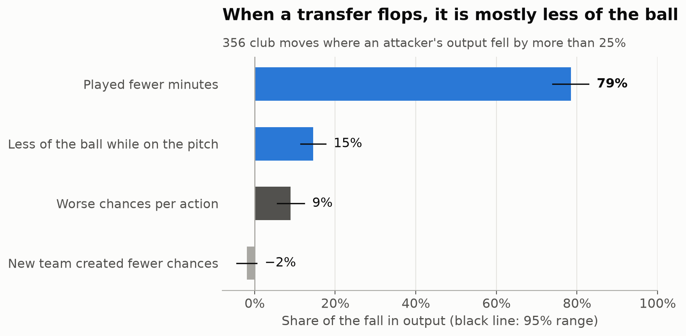
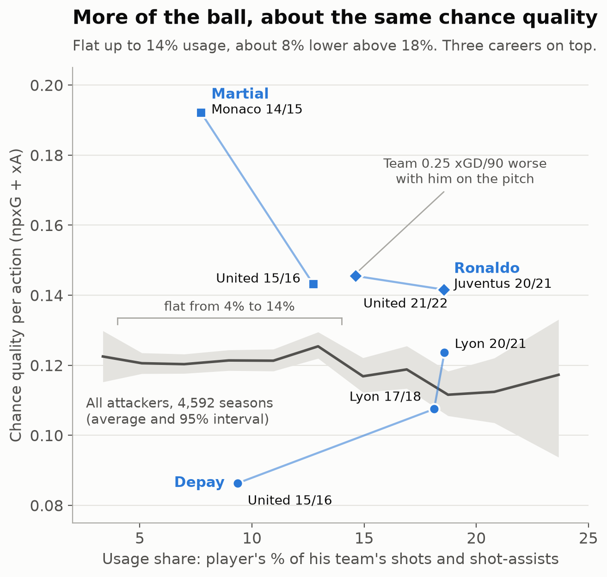
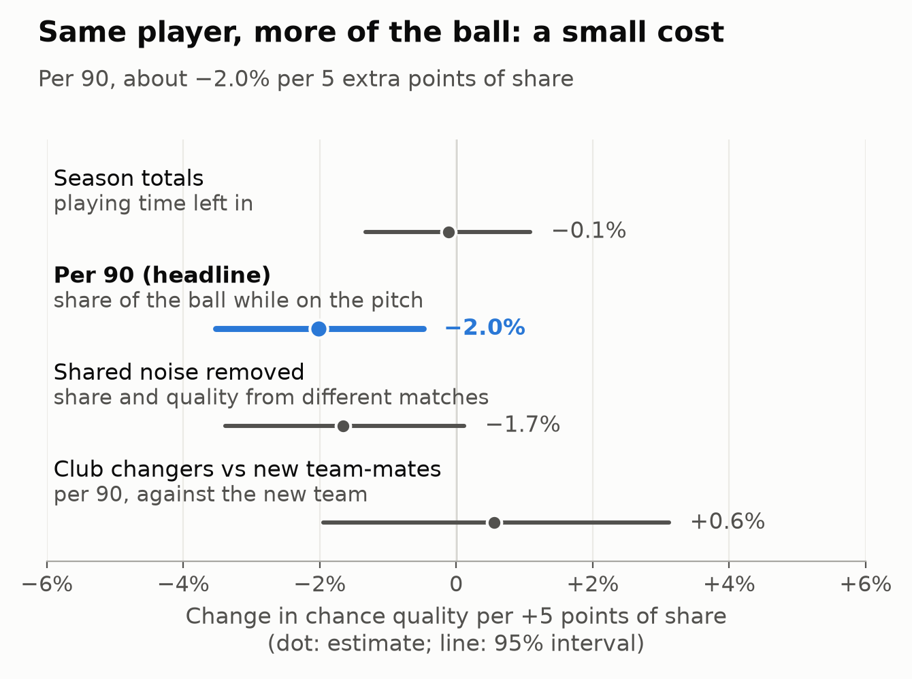

# Why do transfers fail? A look at usage rates in football

**When an attacker's output falls after a move, is it because he got worse, or because of the situation he joined?**

Everything here is per 90 minutes, so playing time is taken out.

## What I found

Mostly the situation. Of 587 club moves by attackers with 900 league minutes either side, 119 saw output per 90 (expected goals plus expected assists) fall by more than 25%, by 41% on average. I split each fall into four parts:

- **28%** came from getting less of the ball while he was on the pitch.
- **20%** came from the new team creating fewer chances per 90.
- **13%** came from the new team-mates' chances being worse.
- **39%** came from the player doing worse than his new team-mates.

So around six tenths of a typical flop is the situation and four tenths is the player. The parts multiply back to output per 90 exactly: team chances per 90 × his share of them × team-mates' quality per chance × his quality relative to them.



The second test asks what more of the ball does to the same player. When his per-90 share of the team's shots and shot-assists rises by 5 points, his chance quality falls by about 2.0% (95% interval −3.5% to −0.5%). Across all players, quality peaks at 12–16% share and drops off above 20%.



*Every 95% interval here comes from a bootstrap that resamples whole players.*

## Depay and Ronaldo

Per 90, Depay's share of the ball was about the same at both clubs: 22% at United in 2015-16 and 24% at Lyon in 2017-18. His chance quality changed, from 0.086 per action at United to 0.107 and then 0.124 at Lyon, though the United figure rests on only 69 actions. He also played far more at Lyon (75% and 86% of league minutes, against 43% at United), which is why his season totals look so different.

Ronaldo is the opposite case. His own chance quality held up at United in 2021-22 (0.146 per action, against 0.142 at Juventus), yet United's expected goal difference was 0.25 per 90 worse with him on the pitch. Per-action numbers cannot see that cost, which is why usage matters: the touches he took came out of his team-mates' share. It is one season, so treat it as a pointer rather than proof.

## Terms

- **Share of the ball** (usage): his shots and shot-assists as a share of his team's while he is on the pitch.
- **Chance quality**: expected goals (xG, the chance a shot is scored) plus expected assists (xA, the xG of the shot a pass sets up) per shot or shot-assist, without penalties.

## Why it matters

A team only creates so many chances, so share of the ball works like a conserved quantity: one player's rise comes out of his team-mates'. A signing helps only if his chances beat the ones he takes over.

## How I tested it

The second test follows the same player from one season to the next: 2,646 pairs of seasons from 883 players, 592 of them club changes.

- **Playing time.** A player in form plays more, which inflates season totals. On season totals the effect reads as zero (−0.1%); per 90 it is −2.0%.
- **Shared noise.** One speculative shot raises his share and lowers his quality at once. Measuring share and quality on different matches gives −1.7%.
- **Regression to the mean.** Controlling for last season's quality leaves −1.7% unchanged.
- **Team context.** Club changers show a 2.8% fall, which disappears (+0.6%) against their new team-mates.
- **Minimum minutes.** Below 900 minutes most of a player's chance quality is noise.



For a scout, that means a player's chance quality mostly travels with him.

## Limitations

- **Data.** Understat covers the Big-5 and Russia from 2014-15 to 4 January 2025, so selling leagues (Depay's PSV) are invisible. Only shots and shot-assists count, so this suits attackers.
- **Where, not who.** The split shows where a fall happened. A coach also sets a player's share.
- **Luck in the flops.** Picking moves by a big fall also picks bad luck, which lands mostly in the player's part. Moves where output rose by over a third split much the same way (36% the player), so part of the 39% is noise.
- **Share on the pitch is estimated** from season share and minutes played, assuming the team creates chances at the same rate with him on or off.
- **Team context.** Against team-mates the per-90 slope halves to −1.0% (−2.5% to +0.4%).
- **Only regulars.** The 900-minute floor drops players who stopped being picked, hiding some of the worst flops.
- **Observational.** It shows a pattern and cannot prove a cause.

## How this fits the wider model

This is one question from a private transfer valuation model, whose data cannot be shared. It asks how good a player is (price-blind), what he is worth to a given club and what he will cost. This result supports its assumption that chance quality travels with the player.

## Reproduce

```bash
python -m venv .venv && .venv/bin/pip install -r requirements.txt
export SOURCE_DATA=/path/to/your/raw/data    # layout in data/DATA.md
./run_all.sh
```

This rebuilds every number and figure and runs the self-checks in `src/`, in about two minutes (Python 3.14).

## Data and licences

Shot xG from [Understat](https://understat.com) via [worldfootballR_data](https://github.com/JaseZiv/worldfootballR_data) (Jason Zivkovic); minutes and positions from [Transfermarkt](https://www.transfermarkt.com) via [transfermarkt-datasets](https://github.com/dcaribou/transfermarkt-datasets) (David Cariboo). Both are for non-commercial research, so `data/` holds only aggregates and three players' season numbers. Code is MIT-licensed.

## About

Ben Rimmer, First-class BSc Economics, University of Exeter. benedict.p.rimmer@gmail.com

<details>
<summary>Full method and tables</summary>

### Where the question comes from

Basketball has studied this for 20 years. Dean Oliver's usage rate measures the share of a team's possessions a player ends while he is on the floor, and his skill curves show that most players get less efficient as they are asked to do more.

### Definitions and sample

The definitions are the ones the wider model uses (`src/usage_model/usage.py`), applied unchanged. Penalties and own goals are excluded. An assisted shot counts as an action for both the shooter and the passer, each credited with its xG, so team totals count that xG twice; team-mates' quality is built the same way, so the comparison is like for like.

The per-90 share is the season share (his actions over the team's) divided by the share of the team's league minutes he played. Minutes and positions come from Transfermarkt, joined to Understat through an id crosswalk.

I kept forwards and attacking midfielders (Transfermarkt position "Attack" or "Attacking Midfield") with at least 900 league minutes in a season: 4,592 player-seasons from 1,436 players. Positions are fixed across a player's career. Russian seasons appear only for players the crosswalk could match through a Big-5 season (99 player-seasons). When a player changes club mid-season, I keep the club that holds at least 80% of his actions and drop the season otherwise. That keeps Ronaldo's 2021-22 (one Juventus match, then United).

### Why 900 minutes

I split each team's league matches into odd and even, measured each player's chance quality on each half, and correlated the two.

| League minutes | Seasons | Chance quality reliability | Usage reliability |
|---|--:|--:|--:|
| under 450 | 2,116 | 0.11 | 0.66 |
| 450 to 899 | 1,391 | 0.34 | 0.71 |
| 900 to 1,799 | 2,363 | 0.58 | 0.83 |
| 1,800 and over | 2,229 | 0.73 | 0.87 |

*Reliability is the split-half correlation stepped up to a full season (Spearman-Brown).*

Below 900 minutes most of the variation in chance quality is noise. Above it, more than half is signal. Usage is measured more reliably than chance quality at every level.

### The flop split in detail

A move counts if the player has 900 league minutes and 20 actions in both seasons, at different clubs. Each part's share is its mean log change over the mean log change in output per 90, so the four shares add up to 100%.

| Part | Flops (119, −41%) | 95% interval | Risers (140, +71%) |
|---|--:|--:|--:|
| Share of the ball on the pitch | 27.9% | 19.5% to 36.1% | 19.5% |
| Team chances per 90 | 20.0% | 14.1% to 26.5% | 22.4% |
| Team-mates' chance quality | 12.8% | 6.0% to 19.7% | 21.8% |
| Player relative to team-mates | 39.3% | 30.7% to 47.5% | 36.3% |

*Risers are moves where output per 90 rose by more than a third, the mirror image of a flop. Full output in `data/flop_decomposition.json`.*

### Across players: the curve

I binned player-seasons by per-90 share and computed total value over total actions in each bin, leaving out bins with fewer than 50 seasons. Chance quality peaks at about 0.128 per action at 12% to 16% share and falls to about 0.105 above 22%. On season-total share the same curve is flat at about 0.12 up to 14% (`data/curve_bins.csv` has both). This comparison mixes two things (better players get more of the ball, and better teams make better chances), so the test that matters is the one within players.

### Within players: the full specification

I took every pair of consecutive seasons where the player passed the 900-minute floor in both and regressed the change in chance quality on the change in share. Each pair is weighted by the precision of its change in quality, `1 / (1/actions₁ + 1/actions₂)`, so a pair built on 300 actions counts for more than one built on 60.

Season share is roughly (share of the season played) × (share of play while on the pitch), and the two correlate at 0.85 here, which is why season totals mislead. Holding minutes fixed in the regression gives −2.9%. The per-90 headline is −0.0023 xG+xA per action per 5 points of share, or −2.0% of the median chance quality of 0.115.

The split-half version cannot be run per 90, because minutes are not split by match, so it holds minutes fixed instead. Removing the shared noise cuts the minutes-fixed slope from −2.9% to −1.7%, by about two fifths. The regression-to-the-mean control uses last season's quality measured on the other half of the matches.

| Specification | Pairs | Change per +5 points of share | 95% interval |
|---|--:|--:|--:|
| Season share, nothing fixed | 2,646 | −0.1% | −1.3% to +1.1% |
| Season share, minutes held fixed | 2,646 | −2.9% | −5.2% to −0.6% |
| **Per 90 (headline)** | 2,646 | **−2.0%** | **−3.5% to −0.5%** |
| Split-half, minutes fixed (shared noise removed) | 2,646 | −1.7% | −3.4% to +0.1% |
| Split-half plus last season's quality | 2,646 | −1.7% | −3.4% to +0.1% |
| Per 90, same club both seasons | 2,054 | −0.9% | −2.7% to +0.9% |
| Per 90, changed club | 592 | −2.8% | −5.6% to −0.1% |
| Per 90, changed club, against new team-mates | 592 | +0.6% | −1.9% to +3.1% |
| Per 90, everyone against team-mates | 2,646 | −1.0% | −2.5% to +0.4% |

*Percentages are of the median chance quality (0.115 npxG+xA per action). Intervals come from 2,000 bootstrap draws resampling whole players. Full table in `data/within_slopes.csv`.*

Players who stay at the same club show no clear drop (−0.9%). Club changers fall by 2.8%, and that goes when they are measured against their new team-mates. Against team-mates the pooled slope halves to −1.0%, so part of the headline is the team around the player.

Binned into tenths by the change in per-90 share (`data/within_bins.csv`), losing the ball helps more than gaining it hurts. In the three tenths where share fell most, chance quality rose by 0.004 to 0.006 per action. In the tenth where it rose most, quality barely moved (+0.001).

### The three players in more detail

Season numbers are in `data/case_studies.csv`. Depay's per-90 share barely moved across United and Lyon (22%, 24%, 22%), and he played 86% of Lyon's minutes in 2020-21. At United he was short of minutes and never short of the ball.

Martial's per-90 share was about the same at Monaco in 2014-15 and United in 2015-16 (14% and 15%), and his chance quality fell from 0.192 to 0.143, though the Monaco figure rests on only 61 actions. His United team-mates averaged 0.098 per action, against 0.109 for Monaco's. Over the next five seasons at United he sat between 0.106 and 0.170 at 14% to 20% per-90 share, with no clear pattern.

Ronaldo's chance quality held up at United in 2021-22 (0.146, against 0.142 at Juventus the season before) on a slightly smaller per-90 share (20% against 23%). The wider model's on/off measure has United's xG difference 0.25 per 90 worse with him on the pitch. On a shuffled-identity test that result sits at the 18th percentile, so one season is not enough to call it significant.

### More limitations

- The full usage definition in the wider model adds turnovers, but that data comes from a frozen FBref/Opta snapshot that cannot be shared.
- Russian seasons are thin (99 player-seasons), and there is no Eredivisie, Primeira Liga or Championship, so Antony's Ajax seasons are also invisible.
- Minutes and positions come from Transfermarkt, which is crowd-maintained, and are joined to Understat through a name-matched crosswalk, so a few players may be mismatched or missing. Minutes for 2024-25 are counted to the same date as the shot data.
- If a coach gives the ball to whoever is in form, part of the pattern reflects his choices. The control for last season's quality absorbs the obvious version of this, but not subtler ones.

### The wider model

The model keeps three questions apart:

1. **How good is he?** A talent score built price-blind: market value, wage and fee are never inputs, and the code refuses to fit if a price-like column appears (`src/usage_model/talent.py`, reference copy).
2. **What is he worth to this club?** A club-specific value that turns expected xG difference into league position and then into revenue, including the step in revenue that comes with Champions League qualification.
3. **What will he cost?** A fee model trained on disclosed transfer fees, validated season by season on later seasons only.

The numbers below come from the private repository and cannot be rebuilt from this one. An earlier test found that a usage-weighted efficiency gap predicts the change in a team's xG difference after 2,364 transfers, with a small effect (r = +0.083, interval +0.042 to +0.123).

Out of time, the talent model's undervalued-player screen picked players whose market value doubled within two years at 23.5%, against a base rate of 13.2% (1,806 players screened). It passes two of its four pre-registered tests and fails two. It reads Haaland's injury-shortened 2021-22 at Dortmund as an ordinary season, because it cannot tell a star's injury from a fringe player's time on the bench, and Antony could not be scored at all, because his Ajax season is in the Eredivisie. Its decile test points the right way (the top tenth outgrows the bottom tenth, with an interval clear of zero) but only 5 of 9 steps rise, against a bar of 6. The tests were set before the results were seen and have not been loosened.

### Scripts

| Script | What it does |
|---|---|
| `analysis/build_panel.py` | Builds the player-season panel from raw data into `data/work/` (gitignored) |
| `analysis/analyse.py` | Computes the within-player tests, the curve and the reliability table, and writes the small tables in `data/` |
| `analysis/decompose.py` | Splits each club move's change in per-90 output into four parts (`data/flop_decomposition.json`) |
| `analysis/figures.py` | Draws the three figures from those tables, as PNG and SVG |

</details>
