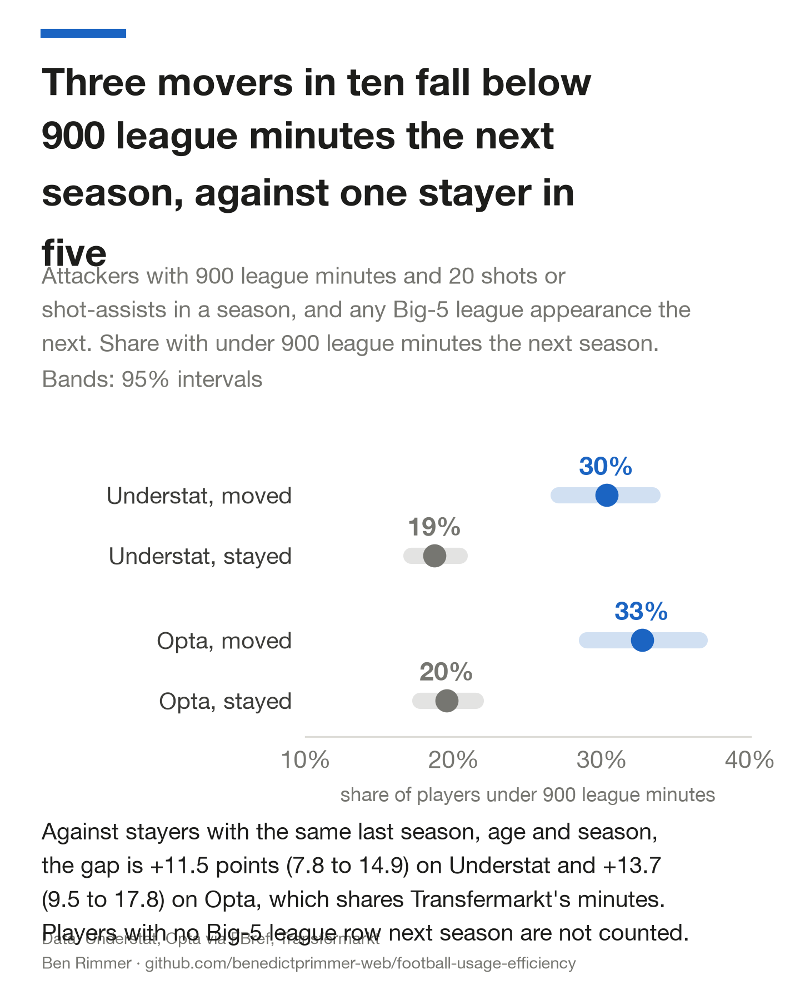
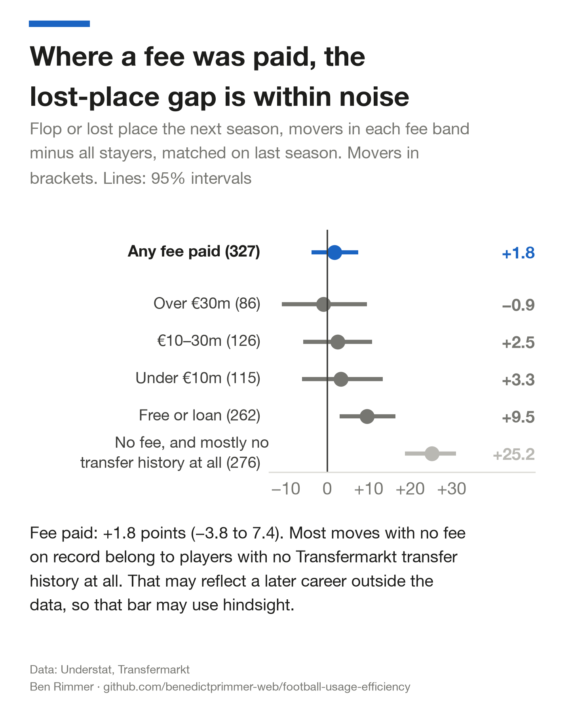

# An attacker after a move: fewer starts, a little less of the ball

**When an attacker's output falls after a move, did he get worse, or did the move change his situation?**

**After a move between two Big-5 clubs, an attacker is about 12 points more likely to flop or lose his place, but where a fee was paid the gap is within noise. If he keeps his place, his share of his team's shots and shot-assists is about 4% lower and his output per 90 shows no measurable change.**

- **Flop or lost place: +11.7 points (95% interval +7.9 to +15.4), matched on last season.** 44% of movers flop or fall below 900 league minutes the next season, against 33% of stayers (raw rates). A flop is output per 90 down by more than 25%; most of the gap is minutes.
- **By fee: +1.8 points (−3.8 to +7.4) where a fee was paid, +9.5 (+3.0 to +16.4) after free or loan moves, +25.2 (+18.8 to +31.0) where Transfermarkt has no fee.** 233 of those 276 no-fee movers have no Transfermarkt transfer history at all, which may reflect a later career outside the data, so that last group may carry hindsight.
- **Starts: 50% of his new club's first 10 league matches after he joins its squad, against 58% for stayers,** a matched gap of −8.2 points (−10.5 to −5.8).
- **Share of shots and shot-assists, for the 601 of 865 movers who keep 900 minutes: −4.1% (−5.8% to −2.4%),** about 0.7 of a point off a 16.9% share. Movers keep their place less often; Lee bounds, which trim stayers so both groups keep their place at the same rate, run from −9.0% to 0.0%, so selection alone could explain it.

**Method.** 865 moves and 2,562 stays by attackers in the Big-5 (the top divisions of England, Spain, Italy, Germany and France), 2014–15 to 2024–25, each after a season of 900 league minutes. Output is xG+xA per 90 (expected goals plus the expected goals of the shots he set up) from Understat, a public xG site. Movers are compared with stayers who had the same last season (decile of share and of output per 90, age band, season) in a regression. Opta's xG, published by the stats site FBref, is a sensitivity check that shares Transfermarkt's minutes, not an independent replication.
**Limits.** Observational and exploratory: nothing was pre-registered, and clubs may sell players they no longer plan to pick. Only moves between Big-5 clubs are in it. No price was tested, so nothing here is a trading signal.

 

## At a glance

| Claim (Understat, matched) | Estimate | Only players who kept 900 minutes? | Survives Holm? | Chosen before looking? |
|---|--:|---|---|---|
| Flop or lost place | +11.7 points (+7.9 to +15.4) | No | Yes | No |
| Flop or lost place, fee paid | +1.8 points (−3.8 to +7.4) | No | No | No |
| Starts, 10 matches from first squad | −8.2 points (−10.5 to −5.8) | No | Yes | No |
| Share of shots and shot-assists | −4.1% (−5.8% to −2.4%) | Yes | Yes | Yes |
| Output per 90 | +1.3% (−1.9% to +4.4%) | Yes | No | Yes |

Holm is a correction for running several tests at once: it controls the chance of any false positive in a family.

## Why it matters

- **Free and loan signings lose their place far more often; paid signings show no measurable difference; nobody has tested a price.** Three movers in ten fall below 900 league minutes the next season (30%, 27% to 33%), against one stayer in five (19%, 17% to 20%).
- **The volume loss among those who keep their place is small, and the sources disagree on why.** On Understat his own open-play shots and shot-assists per 90 do not fall (−0.5%, −2.7% to +1.7%) while his set-piece actions fall by 11.9% (−17.3% to −6.3%). On Opta, which marks only direct free kicks, his actions outside them fall by 3.3% (−5.9% to −0.7%).
- **This is not a trade.** A bookmaker sees the signing date, the registration and the first line-ups, and many books void an anytime-scorer bet on a player who does not play, so only start-or-bench risk before team news is exposed. That market is small, mostly in August and September, and no price, margin or cost was tested here.

## Method

- **Sample.** Attackers (centre-forwards, wingers and attacking midfielders on Transfermarkt, a public transfer and line-up database) with 900 league minutes and 20 shots or shot-assists in a season, followed by a Big-5 league row the next season. A move is a change of club between the two seasons. 601 of the 865 movers and 2,075 of the 2,562 stayers also reach 900 minutes the next season; the share and output tests use those.
- **Usage.** His share is his shots and shot-assists as a share of his team's while he is on the pitch, with minutes measured match by match from Transfermarkt line-ups and substitutions. Understat gives every shot, its assister and whether it came from open play or a set piece. Penalties are left out.
- **Four parts.** Output per 90 = team actions per 90 while he is on × his share × team-mates' xG+xA per action × his xG+xA per action relative to team-mates. Each change is a log change, 100 times the difference in logs, close to a percentage change for small moves, so the four parts add up to the change in output. The split is accounting, so credit can move between parts.
- **Matching for regression to the mean.** A regression of each change on a mover flag plus dummies for the decile of last season's share, the decile of last season's output per 90, age band and season. A second version reweights stayers to the movers' mix of cells.
- **Second source.** Every test is rerun on Opta's xG for the Big-5 plus Portugal and the Eredivisie, 2017–18 to 3 February 2025.

## Inference

- **Primary family: four tests on Understat, Holm-corrected, named on 6 November 2026 after the results had been seen.** The matched gaps in share, own actions per 90, output per 90 and flop or lost place. Share and flop-or-lost-place reach the bootstrap's floor (p at or below 0.0005; Holm-adjusted 0.002), and own actions survives (adjusted 0.026); output does not (adjusted 0.418). An earlier version counted the same tests on both sources as eight; Opta is now its own family, which gives the same pattern.
- **A second family, also chosen after looking: the five fee bands, both starts measures and the no-fee moves without loan returns.** Free or loan (adjusted 0.008), no fee on record (adjusted 0.006) and both starts measures (adjusted 0.004) survive; none of the three paid bands does.
- **Nothing was pre-registered.** "Flop or lost place" was added after a first look showed the 900-minute floor hid lost places. Since then the floor (450, 900, 1,350 minutes), the flop line (15%, 25%, 35%), several exclusions, two luck benchmarks and the fee and starts splits have been tried; the tables show all of them. Every result here is exploratory.
- **The smallest gap the matched comparison could see with 80% power is about 5 points** (5.1 for flops, 5.3 for flop or lost place), and more within a fee band.
- **The slice family: 11 tests (age bands, fee bands among regulars, league path, buying clubs, the predictor), also Holm-corrected.** On Understat only the predictor survives (p = 0.002, adjusted 0.022); the 26–28 age gap has p = 0.029, adjusted 0.29. On Opta the predictor (adjusted 0.005) and the league path (adjusted 0.009) survive.
- **Intervals resample whole players, 2,000 times.** Resampling whole buying club-seasons instead, since team-mates at a new club share its changes, gives −4.1% (−5.9% to −2.3%) for the share gap and +11.7 points (+7.9 to +15.6) for flop or lost place.

## Results

### After a move his share is 4–6% lower; on Understat, set pieces and a busier new team account for most of it

| Movers minus stayers | Understat, raw | Understat, matched | Opta, raw | Opta, matched |
|---|--:|--:|--:|--:|
| His share of the ball | −4.4% (−6.4% to −2.3%) | −4.1% (−5.8% to −2.4%) | −6.5% (−8.9% to −4.1%) | −6.1% (−8.2% to −4.1%) |
| His own shots and shot-assists per 90 | −1.9% (−4.3% to +0.2%) | −2.6% (−4.8% to −0.6%) | −3.3% (−6.0% to −0.5%) | −3.5% (−6.0% to −1.1%) |
| His team's actions per 90, without him | +3.4% (+1.4% to +5.4%) | +2.4% (+0.5% to +4.3%) | +4.7% (+2.4% to +7.0%) | +4.0% (+1.8% to +6.1%) |
| Output per 90 | +3.6% (+0.2% to +6.9%) | +1.3% (−1.9% to +4.4%) | +0.4% (−3.4% to +4.1%) | −0.7% (−4.1% to +2.4%) |
| Flop rate, points | +1.4 (−2.1 to +4.9) | +3.2 (−0.4 to +6.8) | +4.2 (−0.1 to +8.7) | +5.1 (+1.0 to +9.4) |

"His share of the ball" means his share of the team's shots and shot-assists while he is on, not possession or touches. Three team numbers appear in this section: the chances his team creates while he is on (+1.5% matched, a part in fig0), the same without his own actions (+2.4% matched, the table), and the buying club's shots and shot-assists per match the season before the move (+2.9%).

- **About three fifths of the matched share fall is fewer actions of his own, and two fifths is a team that does more.** His own actions per 90 fall by 2.6% against a share fall of 4.1%. Reweighting instead of regression gives −4.0% (−5.8% to −2.2%) on Understat and −6.6% (−8.8% to −4.2%) on Opta.
- **On Understat, his own fall is set pieces.** Matched, his open-play actions per 90 change by −0.5% (−2.7% to +1.7%) and his set-piece actions by −11.9% (−17.3% to −6.3%). His shots fall by 4.2% (−7.0% to −1.7%) and his shot-assists do not change (−0.1%, −3.5% to +3.1%). Opta marks only direct free kicks, and outside them his actions still fall, so on Opta set pieces explain less of it.
- **His share of open play still falls, because the new team makes more.** Measured match by match on open-play actions only, his share falls by 2.4% (−4.2% to −0.6%) on Understat, while the team's open-play actions per 90 with him on rise by 1.9% (0.0% to +3.9%), an interval that reaches zero.
- **The better team is visible before the move.** The clubs movers join made 2.9% (1.2% to 4.4%) more shots and shot-assists per match the season before than the clubs they left (Opta 2.6%, 0.7% to 4.5%). That is a small step up: 54% (50% to 58%) of movers joined a club that made more, close to an even split.

### Playing time: three movers in ten lose their place, mostly after free, loan or unrecorded moves

| | Understat movers | Understat stayers | Opta movers | Opta stayers |
|---|--:|--:|--:|--:|
| No 900-minute season next (under 900 minutes or 20 actions, or split between clubs) | 31% (27% to 33%) | 19% (17% to 21%) | 33% (29% to 37%) | 20% (18% to 22%) |
| Flop or below 900 minutes | 44% (41% to 47%) | 33% (32% to 35%) | 49% (45% to 52%) | 35% (33% to 38%) |
| Gap, matched | +11.7 points (+7.9 to +15.4) | | +14.1 points (+9.6 to +18.6) | |

- **This is the largest and clearest gap in the study.** It survives matching on last season, age adjustment (+11.8 points, +7.9 to +15.7) and the Opta rerun. On minutes alone (under 900 league minutes), the matched gap is +11.5 points (+7.8 to +14.9) on Understat.
- **It holds under the checks the share gap gets** (Understat, matched, flop or lost place):

| Check | Gap, points |
|---|--:|
| Also matched on last season's share of his club's minutes | +10.7 (+7.0 to +14.3) |
| Without moves to promoted or from relegated clubs | +9.9 (+5.5 to +14.2) |
| Without likely loans | +10.6 (+6.5 to +14.5) |
| Without either | +8.6 (+3.9 to +13.2) |
| Floor at 450 minutes, minutes only | +3.8 (+1.3 to +6.1) |
| Floor at 1,350 minutes, minutes only | +14.0 (+10.1 to +18.0) |
| Every season with no Big-5 row next season counted as lost | +15.3 (+11.9 to +18.7) |
| Every season with no Big-5 row next season counted as kept | +5.7 (+2.5 to +8.7) |
| Split-season players brought back on their Transfermarkt minutes, the rest counted as lost | +7.7 (+4.2 to +11.0) |
| Also matched on his share of minutes in the second half of last season, and on goals minus xG | +10.2 (+6.3 to +13.7) |
| Stayers reweighted to the movers' mix of cells | +11.1 (+7.0 to +15.0) |
| Buying club made more shots the season before | +8.1 (+3.2 to +13.5) |
| Buying club did not | +13.0 (+6.8 to +18.6) |
| Fit all next season (under 30 days out) | +12.4 (+7.8 to +17.4) |
| Injured 30 days or more | +11.0 (+4.8 to +17.1) |

- **Who drops out decides the range.** 845 of 4,272 qualifying seasons have no Big-5 row the next season: sold abroad or down a division, relegated with the club, injured all season, not matched, or split between two clubs (the sample keeps a season only when one club holds 80% of his actions). 315 of them show a Transfermarkt transfer away from his club, and 191 played Big-5 league minutes the next season, 125 of them 900 or more. The gap is +5.7 points if every dropout kept his place and +15.3 if every one lost it.
- **The gap sits in free, loan and unrecorded moves.** Each fee band against all stayers, matched (also fig7):

| Moves | Movers | Gap, points |
|---|--:|--:|
| Any fee paid | 327 | +1.8 (−3.8 to +7.4) |
| Over €30m | 86 | −0.9 (−11.0 to +9.6) |
| €10–30m | 126 | +2.5 (−5.8 to +10.8) |
| Under €10m | 115 | +3.3 (−6.0 to +13.4) |
| Free or loan | 262 | +9.5 (+3.0 to +16.4) |
| No fee on record | 276 | +25.2 (+18.8 to +31.0) |
| Every move except those with no fee on record | 589 | +5.4 (+0.9 to +9.6) |

- **What a "no fee on record" move is.** Of the 276, 272 have no Transfermarkt transfer row into the new club at all, only 1 is a loan ending, and 233 belong to players with no Transfermarkt transfer history anywhere. They cluster in early seasons (59 of 103 moves in 2014–15, 2 of 77 in 2023–24). The mirror is built from players it still follows, so a missing history may mean a career that later left its coverage, which is information from after the move. On Opta the paid bands are less clean: +4.5 (−2.1 to +10.6) for any fee, +11.9 (+1.4 to +22.4) under €10m.
- **Loan endings.** 55 moves are a player going back to a club that had loaned him out; without them the gap is +12.0 (+8.3 to +15.8).
- **Starts.** Movers start 50% of the 10 league matches from their first matchday squad at the new club, against 58% for stayers, matched −8.2 points (−10.5 to −5.8); on Opta −9.2 (−12.1 to −6.2). Counting the club's first 10 matches of the season instead gives −14.2 (−16.8 to −11.6), but movers' first squad comes after 3.0 of those matches on average, against 0.8 for stayers, so about two fifths of that larger gap is matches played before he arrived. Movers had played slightly less in the second half of their last season too (58% of their club's minutes against 60%), which the matching on late-season minutes allows for.

## Robustness

- **Opta, seven leagues.** The usage cost holds and is larger (−6.5% raw, −6.1% matched), and in open play it is −6.0% (−8.2% to −4.0%). Output per 90 roughly breaks even (+0.4%, −3.4% to +4.1%). The predictor scores 0.70 (0.64 to 0.77) pseudo out of time, helped by easy cases: moves up from Portugal and the Eredivisie, which the change-of-league input picks up. FBref's 2024–25 files stop on 3 February 2025.
- **Position on the team sheet.** Transfermarkt gives one position per player, as of 2026. Keeping only pairs where his starting line-up position was an attacking one in both seasons (91% of pairs), the share gap is −4.1% (−5.7% to −2.5%).
- **Name matching.** Understat and Transfermarkt are joined by names within each league-season, using club to settle clashes. 93% of Understat's non-penalty shots belong to a player matched to Transfermarkt; the worst league-season is La Liga 2017–18, at 85%.
- **Loans, promoted and relegated clubs.** Transfermarkt does not flag loans, so a move counts as a likely loan when the player went back to the selling club within two seasons (109 moves). The flag uses what happened later, so it is a check, never an input to a prediction. Without them the share gap is −4.8% (−7.0% to −2.6%). Without the 52 moves to promoted clubs and 114 from relegated clubs it is −4.1% (−6.2% to −1.9%).


## Limits

- **Observational.** Clubs choose whom to buy and coaches choose a player's share; matching removes only what last season's numbers show.
- **Only moves between Big-5 clubs.** Players sold to the Championship, Turkey, Saudi Arabia or MLS have no Big-5 row the next season and drop out, as do stayers relegated with their club. Counting them moves the lost-place gap from +5.7 to +15.3 points.
- **Who is sold.** A selling club may let go a player it no longer plans to pick. Matching on his minutes in the second half of last season catches part of that; what the club knew and the data do not is untested.
- **League minutes only.** A player at a club in Europe can lose league minutes to rotation without losing his place.
- **January moves are not in it.** A season counts only when one club holds 80% or more of a player's actions, so a player who changed club mid-season drops out of that season.
- **Position is today's.** The sample uses Transfermarkt's position as of 2026; the line-up check above covers it for attackers.
- **Shots and shot-assists only.** Carries, pressing and build-up passes are invisible, so this suits attackers.
- **The four-part split is accounting.** His own actions count in the team's total, and his quality is measured against team-mates', so credit shifts between parts, and the parts' changes correlate.
- **Leagues and years.** Understat covers the Big-5 to 15 September 2025; the Opta rerun adds Portugal and the Eredivisie to 3 February 2025. Moves from the Championship, Belgium or Brazil are invisible.
- **Not a trading signal.** No betting, fantasy or player-prop market was tested, and no costs or capacity are estimated. The market test would be whether pre-team-news anytime-scorer or shots prices for a signing's first 10 matches already allow for the 14-point fall in starts; that needs odds history this repo does not have.

## What would change my mind

- If a club's own tracking data showed movers keep their touches and lose only shots, the usage cost would be about who finishes moves, and his involvement would be unchanged.
- If the share and starts gaps vanish once each player's intended role at the buying club is known (scouting reports, contract length), they are about which players are bought, not the move.
- If predictions frozen before 2026–27 do no better than chance on lost places, the predictor is noise.
- If a fresh Transfermarkt copy with full transfer histories shows the no-fee moves are ordinary paid moves, the fee split above is a data artefact, and the gap for paid moves would need retesting.
- If the lost-place gap among paid moves stays within noise on a larger sample, the minutes risk belongs to free, loan and unrecorded moves, not to moving as such. Today it is +1.8 points (−3.8 to +7.4) where a fee was paid.

## Reproduce

```bash
python -m venv .venv && .venv/bin/pip install -r requirements.txt
./run_all.sh --quick                                # figures from the shipped tables, about 30 seconds
export SOURCE_DATA=/path/to/your/raw/data          # layout and checksums in data/DATA.md
./run_all.sh                                        # everything from raw data
```

The full run rebuilds every number and figure, runs the self-checks, and checks every number quoted in this README, `docs/more_results.md` and `docs/side_studies.md` against the tables in `data/` (`analysis/verify.py` prints PASS or FAIL for each). It takes about 30 minutes on a laptop, most of it the StatsBomb files and the bootstraps. A self-check asserts that a player on for every league minute sees all his team's actions, stoppage time included (median ratio 1.000 across 269 such seasons). A full run on 6 November 2026 reproduced every committed table byte for byte. The Transfermarkt copy (built 5 September 2026) cannot be downloaded again, so a third party can rebuild from raw data only with a copy whose checksums match `data/DATA.md`. A second `./run_all.sh --quick` leaves `git status` clean: figures and the one-pager carry no timestamps. Python 3.14, versions pinned in `requirements.txt`.

## Data and licences

- **Shots and xG:** [Understat](https://understat.com) via [worldfootballR_data](https://github.com/JaseZiv/worldfootballR_data) (Jason Zivkovic), 2014–15 to 15 September 2025.
- **Opta xG, seven leagues:** [FBref](https://fbref.com) via worldfootballR_data, 2017–18 to 3 February 2025.
- **Minutes, line-ups, substitutions, transfers:** [Transfermarkt](https://www.transfermarkt.com) via [transfermarkt-datasets](https://github.com/dcaribou/transfermarkt-datasets) (David Cariboo).
- **Side studies:** [StatsBomb open data](https://github.com/statsbomb/open-data), [American Soccer Analysis](https://www.americansocceranalysis.com) (CC BY-SA 4.0), the [FPL archive](https://github.com/vaastav/Fantasy-Premier-League) (MIT), [salimt/football-datasets](https://github.com/salimt/football-datasets), [Impect open data](https://github.com/ImpectAPI/open-data) and the [Wyscout public dataset](https://figshare.com/collections/Soccer_match_event_dataset/4415000) (CC BY 4.0).

None of the raw data is in this repository. `data/LICENSE.md` maps every committed file in `data/` to its source and terms; `data/asa.json` is released under CC BY-SA 4.0. Code is MIT-licensed. For the other aggregates, the figures and the one-pager, the sources' own terms apply and restrict commercial use; Understat, the main source, publishes no licence at all.

 &nbsp; 

## About

Ben Rimmer, First-class BSc Economics, University of Exeter. benedict.p.rimmer@gmail.com

A one-page summary is in [`onepager.pdf`](onepager.pdf), drawn from the same tables. More results (flops against luck, who flops, the predictor and the frozen test, midfielders, MLS, the within-player test) are in [`docs/more_results.md`](docs/more_results.md). Side studies (chemistry between team-mates, StatsBomb, Impect and Wyscout pass checks, Depay and Ronaldo, FPL 2025–26, injuries and free transfers) are in [`docs/side_studies.md`](docs/side_studies.md). How this repo was reviewed is in [`LOOP.md`](LOOP.md).

<details>
<summary>Full method and tables</summary>

### Minutes on the pitch

Transfermarkt line-ups give the starters, and its match events give every substitution and red card, so each player has an on and off minute in every league match (573,444 player-matches in 20,002 games). Understat gives the minute of every shot. Together they say which shots and shot-assists his team made while he was on.

### The four parts, raw

An action is a shot or a shot-assist. Penalties and own goals are excluded. An assisted shot counts for both players, each credited with its xG. The transfer tests need 20 actions in each season as well as 900 minutes, which is why they have 601 moves and the within-player tests have 605.

| Part | Movers minus stayers | 95% interval |
|---|--:|--:|
| His share of the ball | −4.4% | −6.4% to −2.3% |
| Chances his team creates | +2.4% | +0.7% to +4.3% |
| Quality of team-mates' chances | +3.2% | +1.4% to +5.0% |
| His own quality against team-mates | +2.4% | +0.0% to +4.7% |
| Output per 90 | +3.6% | +0.2% to +6.9% |

*Differences in mean log change. Intervals from 2,000 bootstrap draws resampling whole players. Tables in `data/transfers.json`, `data/transfer_splits.csv` and, for the matched versions and the later checks, `data/robustness.json` and `data/rivals.json`.*

### Why 900 minutes

I split each team's league matches into odd and even, measured each player on each half, and correlated the two (stepped up to a full season).

| League minutes | Seasons | Chance quality reliability | Usage reliability |
|---|--:|--:|--:|
| under 450 | 2,539 | 0.19 | 0.88 |
| 450 to 899 | 1,322 | 0.34 | 0.50 |
| 900 to 1,799 | 2,305 | 0.59 | 0.73 |
| 1,800 and over | 2,411 | 0.73 | 0.86 |

Below 900 minutes most of the variation in chance quality is noise.

### Within-player tests

Each pair of seasons is weighted by the precision of its change in quality, `1 / (1/actions₁ + 1/actions₂)`. Percentages are of the median chance quality (0.116 xG+xA per action), per 5 points of share. The split-half version is the headline because share and quality come from different matches, so a lucky match cannot raise both. Full table in `data/within_slopes.csv`.

| Specification | Pairs | Per +5 points of share | 95% interval |
|---|--:|--:|--:|
| **Per 90, split-half (headline)** | 2,693 | **−1.5%** | **−2.9% to −0.1%** |
| Per 90, same matches | 2,693 | −2.1% | −3.9% to −0.4% |
| Per 90, against team-mates | 2,693 | −1.9% | −3.5% to −0.3% |
| Season share split-half, plus last season's quality | 2,693 | −2.0% | −4.0% to −0.2% |
| Season share, minutes held fixed | 2,693 | −3.5% | −5.9% to −1.1% |
| Season share, nothing held fixed | 2,693 | −0.3% | −1.5% to +0.9% |
| Per 90, same club both seasons | 2,088 | −1.3% | −3.2% to +0.6% |
| Per 90, changed club | 605 | −2.0% | −5.1% to +1.1% |
| Per 90, changed club, against new team-mates | 605 | 0.0% | −2.6% to +2.8% |

### The luck benchmarks

For each pair of seasons, the three situation parts stay as observed. The change in his quality against team-mates is replaced by pure sampling noise: his actions in each season are redrawn with replacement from his own pooled actions over both seasons, so his true quality is the same in both, and the noise is the log change in the mean. Flops are then selected and split exactly as in the data. 200 runs each for movers and stayers; draws in `data/noise_benchmark_draws_*.csv`. The first benchmark keeps the observed change in his share of the ball, so it ignores the negative link between share and quality within a season. The second redraws his action count in each season as binomial on his team's actions while he was on, at his pooled share, and redraws his quality with those counts (`analysis/robustness.py`). "Data minus luck" pairs a bootstrap draw of the data with a random benchmark run, 2,000 times (`analysis/rivals.py`).

### The flop predictor

A ridge-penalised logistic regression on six standardised inputs known on the day of the move: age, output per 90, quality against team-mates, share of the ball, share of minutes played, and whether the move changes league. Trained on moves where the first season starts in 2018 or earlier, tested on the rest. The frozen version and how to score it are in `data/flop_model_frozen.json`; `analysis/score_frozen.py` scores it. A rebuild never rewrites the frozen files; it only checks that it would produce the same predictions.

### Scripts

| Script | What it does |
|---|---|
| `analysis/crosswalk.py` | Joins Understat and Transfermarkt matches and players |
| `analysis/minutes.py` | On and off minutes for every player in every league match, and minutes together for every pair |
| `analysis/build_panel.py` | The player-season panel, in `data/work/` (gitignored) |
| `analysis/analyse.py` | Within-player tests, reliability, the usage curve |
| `analysis/transfers.py` | Movers against stayers, the luck benchmark, slices, the flop predictor |
| `analysis/robustness.py` | Matching for regression to the mean, the denominator, lost places, loans and promotion, the second luck benchmark, Holm, the frozen predictor |
| `analysis/rivals.py` | The lost-place checks, survival, set pieces and open play, the flop line, club-season intervals, line-up position, name match, data minus luck, the primary family |
| `analysis/score_frozen.py` | Scores the frozen 2025–26 predictions |
| `analysis/chemistry.py` | Pair chemistry from shot assists |
| `analysis/statsbomb.py`, `analysis/sb_check.py` | StatsBomb 2015–16 checks |
| `analysis/fbref.py` | FBref/Opta shots for seven leagues, for the `SHOTS=opta` rerun |
| `analysis/figures.py` | Every figure and the one-pager |
| `analysis/verify.py` | Checks the README's and side studies' numbers against `data/` |

</details>
