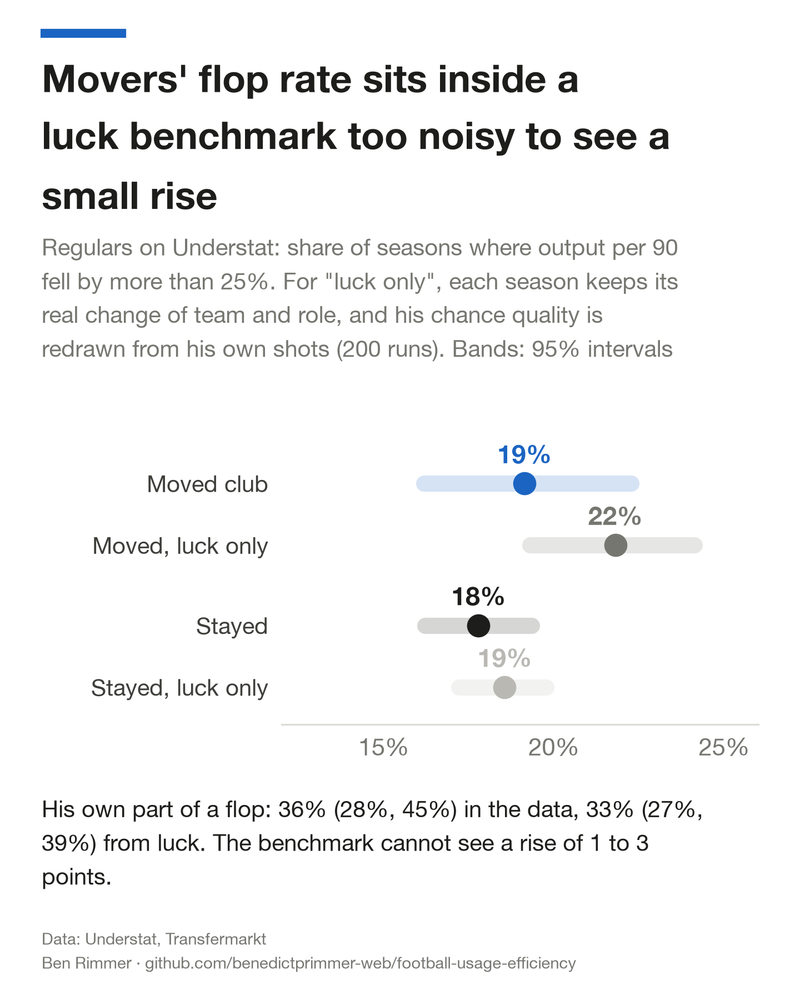
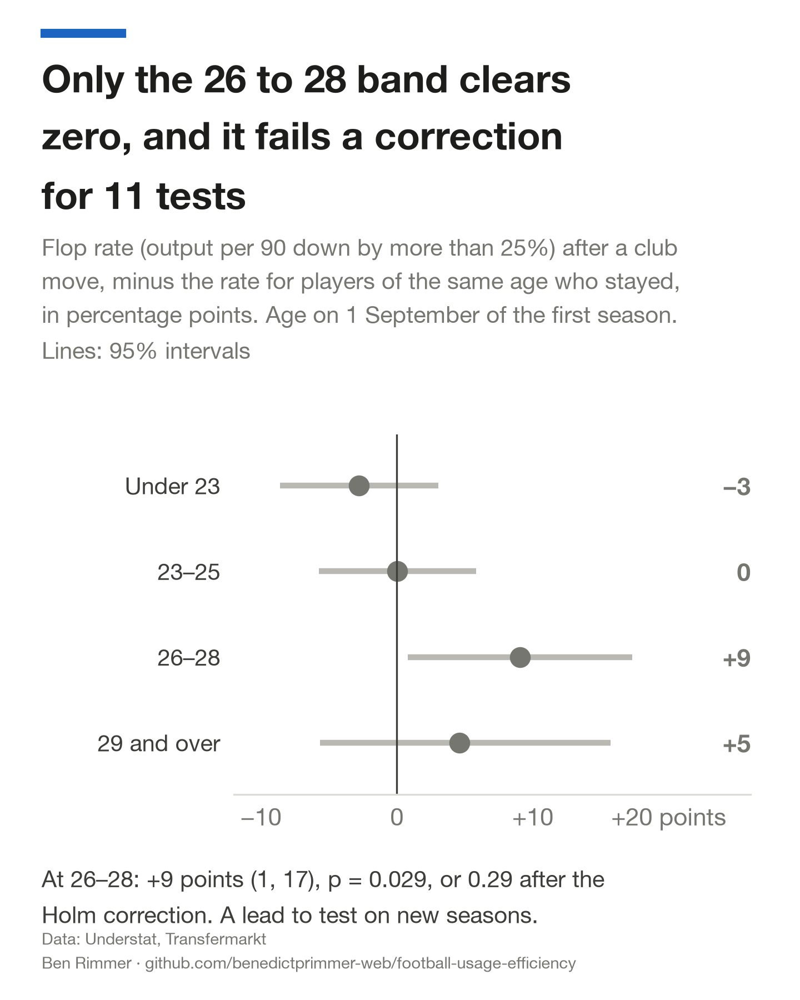
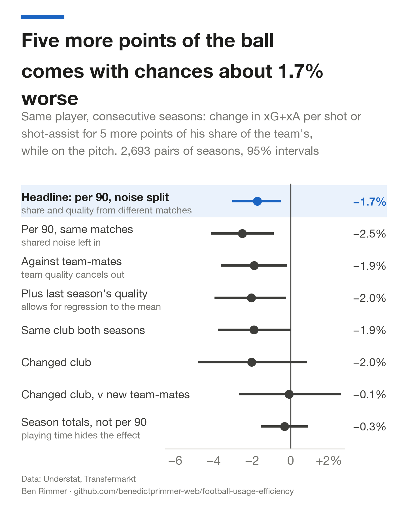

# More results

Results that sit behind the [README](../README.md)'s finding: flops among regulars against a luck benchmark, who flops, the flop predictor and the frozen 2025–26 test, midfielders, MLS and the within-player test. Every number here is checked against `data/` by `analysis/verify.py`, like the README's. Intervals are 95% and resample whole players.

### Among regulars, the luck benchmark cannot tell movers from luck

Picking moves by a big fall also picks bad luck, so I measured how much luck alone produces. For each pair of seasons I kept the real change of team and role, fixed the player's quality against his team-mates, and redrew his chance quality from his own shots, 200 times. A second benchmark also redraws his share of the ball from his own pooled share, so both his role and his quality are fixed.

| | Flop rate, data | Luck only | Luck only, share redrawn too | Player's part of a flop, data | Player's part, luck only |
|---|--:|--:|--:|--:|--:|
| Moved club | 19% (16%, 22%) | 22% (19%, 24%) | 20% (18%, 23%) | 36% (28%, 45%) | 33% (27%, 39%) |
| Stayed | 18% (16%, 19%) | 19% (17%, 20%) | 19% (17%, 20%) | 42% (38%, 46%) | 39% (36%, 42%) |

- **Data minus luck: −2.7 points (−6.5, 1.1) for movers on Understat, −1.3 (−6.1, 2.9) on Opta.** This includes the data's own resampling uncertainty. The benchmark runs about a point high on stayers too, so it cannot detect a real rise of 1 to 3 points in movers' flop rate.
- **The player's own part of a flop is within the luck band.** 36% (28%, 45%) in the data, against 33% (27%, 39%) from luck. About 73% (65%, 84%) of the spread in a mover's change of quality against team-mates is what sampling noise alone would give.
- **Against stayers, movers flop a little more often.** Matched, the gap is +3.2 points (−0.4, 6.8) on Understat and +5.1 (1.0, 9.4) on Opta. With the flop line at a 15% or a 35% fall instead of 25%, the Understat gap is +2.2 (−2.0, 6.4) and +3.7 (0.9, 6.4).
- **Losing the ball accounts for 27% (19%, 35%) of the average mover's flop on Understat,** and 32% of movers' flops (24%, 41%) would not have been flops had his share held.

### Who flops: only the predictor survives the multiple-testing correction

| Test (Understat) | Estimate | p | Holm p |
|---|--:|--:|--:|
| Predictor, AUC above 0.5 | 0.63 (0.55, 0.71) | 0.002 | 0.022 |
| Age 26–28, movers v stayers | +9.1 points (0.8, 17.3) | 0.029 | 0.29 |
| Fee under €10m v other movers | −7.4 points (−15.0, 0.4) | 0.070 | 0.63 |
| Changed league v same league | +5.1 points (−1.4, 11.6) | 0.12 | 0.92 |
| Buying clubs, early v late record | rank correlation −0.10 | 0.77 | 1.00 |

- **Age.** Movers aged 26 to 28 flop 28% (20%, 36%) of the time, against 19% (16%, 22%) for stayers of the same age. The other three bands' gaps all include zero.
- **League.** Players who move to a new league flop 22% (17%, 28%) of the time, against 17% (14%, 21%) for movers within the same league. On Opta, where the new league is often a step up from Portugal or the Eredivisie, the gap is +12.6 points (4.8, 19.6) and survives the correction.
- **Fee.** Moves over €30m flop 20% (11%, 28%) of the time, €10–30m moves 17% (10%, 25%), moves under €10m 13% (6%, 20%), and free or loan moves 19% (14%, 25%); every interval overlaps. 149 of these regulars' moves have no fee on record in Transfermarkt.
- **Buying club.** After shrinking each club's record towards the average, the spread between clubs is close to zero, and only 11 clubs made enough signings to compare 2015–19 with 2020–25 (rank correlation −0.10, p = 0.77).

 

### The predictor is mostly last season's output, and no prospective test has been run

- **On regulars who keep their place, a simple model gives a pseudo-out-of-time AUC of 0.63 (0.55, 0.71).** AUC is the chance it ranks a random flop above a random non-flop, where 0.5 is a coin toss. The model is a logistic regression with a light ridge penalty on six inputs known on the day (age, output per 90, quality against team-mates, share of the ball, share of minutes, change of league). It is trained on moves into 2015–16 to 2019–20 and tested on 2020–21 onwards (280 moves). "Pseudo" because the test seasons existed when the inputs were chosen.
- **Most of that is regression to the mean.** A flop is a fall from last season, so a big last season predicts one: last season's output per 90 alone scores 0.62 (0.54, 0.70) on the same test moves.
- **On every move in the sample, it does about as well: 0.65 (0.59, 0.70) for "flop or lost his place" across 400 test moves.** Counting players who lost their place as non-flops gives 0.64 (0.56, 0.71), and predicting lost places alone 0.68 (0.62, 0.73). An AUC in the low 0.60s on a few hundred moves has no stated use.
- **The 2025–26 "frozen" test is not prospective.** The model in `data/flop_model_frozen.json` and its predictions for 80 moves into 2025–26 in `data/predictions_2025_26.csv` were committed at 20:50 on 3 November 2026 and scored 19 minutes later. The Transfermarkt minutes for 2025–26 were already on disk, and 2025–26 Premier League outcomes from FPL had been committed 30 minutes before the freeze. On lost places, 21 of the 80 fell below 900 league minutes and the model ranks them with an AUC of 0.54 (0.40, 0.68), no better than chance. The test set also held 4 moves to clubs outside the Big-5 and 8 January moves (2 moves were both); without them, and counting minutes at the new club only, it is 0.52 (0.37, 0.68) on 70 moves. The commit that froze it (5845cab) says it came before any 2025–26 outcome was read; that is wrong, for the reasons above. After the stoppage-time fix below, a rebuild would give slightly different predictions; the frozen file is kept as committed. Flops cannot be scored, because no source here has 2025–26 Understat shots.
- **A prospective test needs a newer Transfermarkt copy.** Of the 2,850 transfers this copy dates 1 June to 1 September 2026, 2,799 are dated 30 June or 1 July, when loans end and contracts turn over, so the summer 2026 window is missing. The next step is to freeze predictions for summer 2026 moves as soon as a copy with that window exists, before any 2026–27 minutes are in it.

### Midfielders, MLS and the same player with more of the ball

- **Midfielders who are not attacking midfielders lose about 1.6 times as much of the ball.** On Understat their share falls by 9.3% (−12.7%, −6.1%) raw and 6.7% (−10.0%, −3.8%) matched, and output per 90 falls by 5.2% (−10.6%, 0.2%). They flop 33% (28%, 37%) of the time against 24% (23%, 26%) for midfielders who stay, +9.5 points after age (4.0, 14.5), and 53% of them flop or lose their place against 39% of stayers, +16.3 points matched (11.6, 20.4). On Opta the share falls by 11.8% (−15.9%, −7.6%). The sample uses today's Transfermarkt position, so a winger later moved back into midfield counts as a midfielder in every season.
- **MLS (Major League Soccer), a league outside Europe with a salary cap.** From [American Soccer Analysis](https://www.americansocceranalysis.com) player-seasons, with share estimated from season totals rather than minutes on the pitch, 153 attacker moves show the same usage cost: share falls by 3.8% (−7.3%, −0.4%), the new team does not create more chances: −0.6% (−3.0%, 2.0%), and movers flop more often than stayers (25% against 18%), a gap of +8.0 points (0.8, 15.7).
- **The same player with more of the ball.** Following one player from one season to the next (2,693 pairs of seasons from 897 players), seasons where his share was 5 points higher came with chance quality 1.5% lower (−2.9%, −0.1%), with share and quality measured on different matches. The typical move cuts a player's share by about 0.7 points (4.1% of a 16.9% share, matched), which on this slope is worth about 0.2% in chance quality. Among movers measured against their new team-mates the slope is 0.0% (−2.6%, 2.8%).

