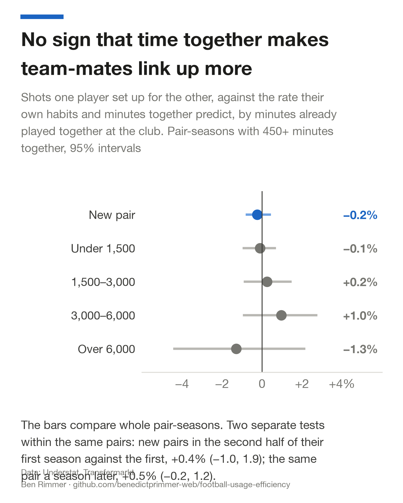
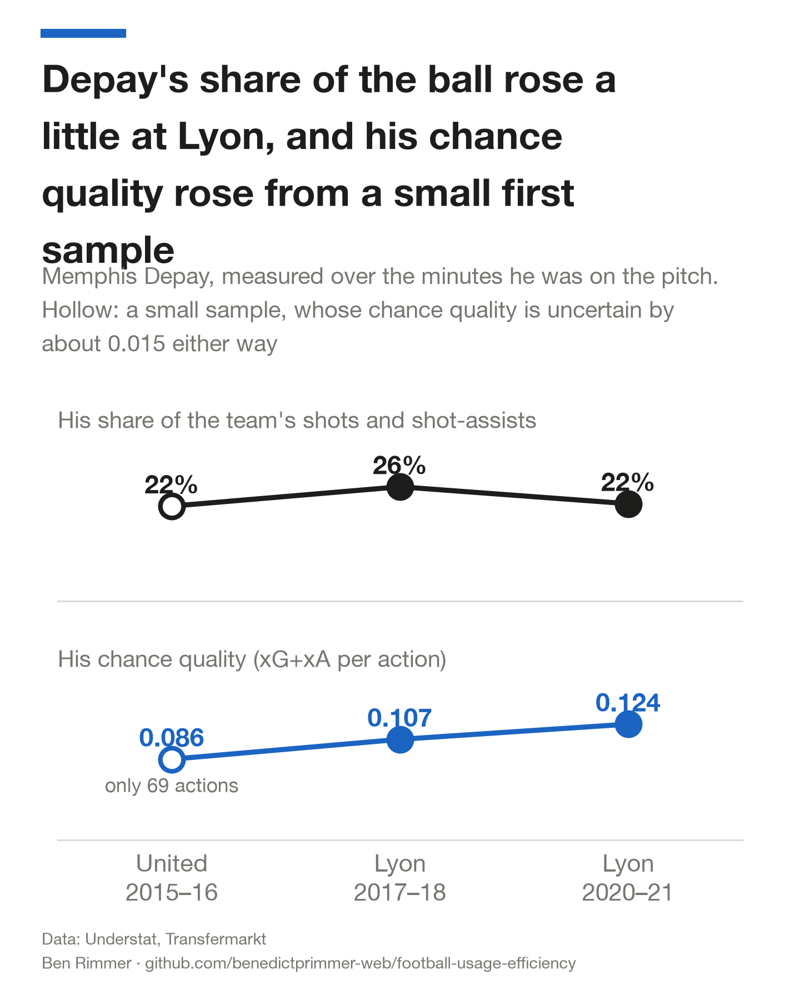

# Side studies

Checks that sit beside the main finding in the [README](../README.md). Each is exploratory, like the rest of the repo, and every number here is checked against `data/` by `analysis/verify.py`. Intervals are 95% and resample whole players (or whole pairs, for chemistry).

## Chemistry: no sign that time together helps

Do two team-mates link up more the longer they play together? For every pair I counted the open-play shots one set up for the other, and compared that with what their own habits and their minutes together predict. That expected rate comes from a model with one term for how much the passer sets up and one for how much the receiver finishes from set-ups, fitted club by club and season by season.

- **New pairs set up 0.4% more in the second half of their first season than the first (−1.0% to +1.9%, 20,786 pairs).** The same pair a season later: +0.5% (−0.2% to +1.2%).
- **Some pairs do link up more than expected, season after season.** A pair's excess set-ups in one season predict the next (correlation 0.10, against 0.01 at the 95th percentile when pairs are shuffled). It could reflect how two players' roles and positions fit together, which this test cannot separate from other lasting traits of a pair.
- **Old team-mates reunited at a new club start 2.3% ahead of new pairs (−2.3% to +6.8%), within the noise.**

The pairs that beat their expected rate most over their time together, after shrinking small samples towards average (a single estimate each):

| Pair | Minutes together | Set-ups | Expected | Ratio, shrunk |
|---|--:|--:|--:|--:|
| Lionel Messi & Neymar | 9,681 | 189 | 154 | 1.09 |
| Marek Hamšík & Lorenzo Insigne | 8,873 | 165 | 135 | 1.09 |
| Gonzalo Higuaín & Paulo Dybala | 4,305 | 72 | 51 | 1.08 |
| Marco Reus & Pierre-Emerick Aubameyang | 4,001 | 60 | 41 | 1.08 |
| Luis Alberto & Mattia Zaccagni | 4,575 | 49 | 31 | 1.07 |

### Checked against StatsBomb passes

StatsBomb (an event-data provider that publishes some seasons free) covers 2015–16 in the Premier League, La Liga, Serie A and Ligue 1 (1,517 matches), with every pass, its receiver and every substitution.

- **The minutes hold up.** For substitutes, Transfermarkt's minute on agrees with StatsBomb's within a minute in 99% of cases.
- **Passing between new pairs changed by −0.1% from the first half of 2015–16 to the second, and between established pairs by +0.1%, a gap of −0.1% (−2.9% to +2.6%).** Passes give about 40 times as many events as shot assists.
- **The two sources see the same pairs.** Pairs who pass to each other more than expected also set up more shots for each other than expected (correlation 0.21, against 0.04 by chance). The fifth with the strongest passing links set up 11% more shots than expected.

### Passes on two more providers

The chemistry test again, on completed passes between new and established pairs from the first half of a season to the second. Impect and Wyscout are event-data providers with free research releases.

| | Impect, Bundesliga 2023–24 | Wyscout, Big-5 2017–18 |
|---|---|---|
| New pairs | 370, −0.5% (−4.6% to +3.9%) | 1,918, −1.1% (−2.8% to +0.8%) |
| Established pairs | 255, +0.1% | 1,531, −0.4% |
| Gap | −0.6% (−7.9% to +6.3%) | −0.7% (−3.5% to +2.1%) |

Three providers and three seasons agree: new pairs do not pass to each other more as a season goes on. Wyscout does not record who received a pass, so the receiver is the next player on the same team to touch the ball (92% of accurate open-play passes).

## Stepping up from Portugal or the Eredivisie

On Opta, 38 attackers moved from those leagues into the Big-5 with 900 minutes either side. Their output per 90 fell by 28% (21% to 35%) and 53% of them flopped. The fall came from the situation (−29%): against their new team-mates their quality was unchanged (−0.5%, −7.1% to +6.2%). It is a small sample.

## FPL 2025–26 in the Premier League

The Fantasy Premier League (FPL) archive ([vaastav/Fantasy-Premier-League](https://github.com/vaastav/Fantasy-Premier-League), MIT) has Opta xG and xA per player per match, but no shots, so it can show output and flops and cannot show share of the ball. From 2024–25 to 2025–26, 18 forwards and midfielders changed Premier League club with 900 minutes either side: 33% flopped (12% to 57%) against 26% (17% to 35%) of 93 who stayed. The sample is too small to say more than that the pattern has not reversed.

## Injuries and free transfers

From a Transfermarkt data lake ([salimt/football-datasets](https://github.com/salimt/football-datasets)):

- **Movers who missed 30 or more days in their first season at the new club flopped 21% (16% to 27%) of the time (236 moves), against 18% (14% to 22%) for those who stayed fit, a gap of +3.4 points (−3.4 to +9.8).**
- **Moves on a zero fee (free or loan) flopped 19% (14% to 25%) of the time, against 16% (12% to 21%) where a fee was paid.** Neither gap is clear of noise, and the 900-minute floor hides the worst injuries.

## Depay and Ronaldo

Memphis Depay is the standard example of a flop who came good. Measured over his minutes on the pitch, his share of the ball was similar at United in 2015–16 (22%) and Lyon in 2017–18 (26%). His chance quality rose from 0.086 per action to 0.107, and to 0.124 in 2020–21, though the United figure rests on only 69 actions. He also played far more: 43% of United's league minutes, against 72% and 86% at Lyon. These are single seasons of one player, so they carry no interval.

Ronaldo went the other way. His chance quality held up at United in 2021–22 (0.145 per action, against 0.142 at Juventus the season before) on a smaller share (18%, against 22%). One season cannot say whether his share cost his team-mates.

 
